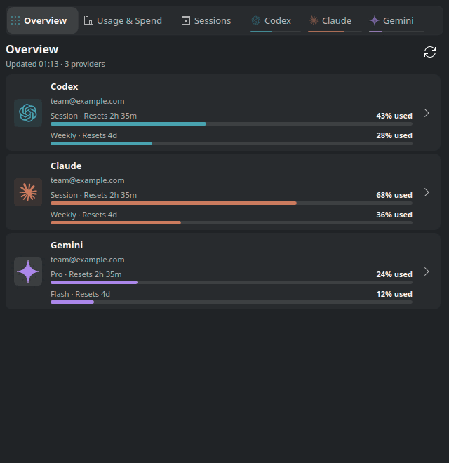
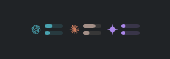
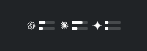
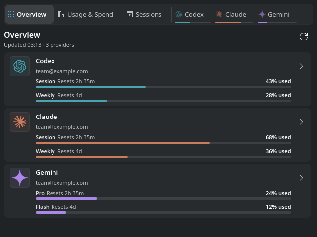
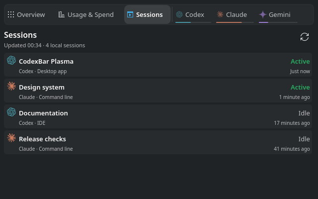
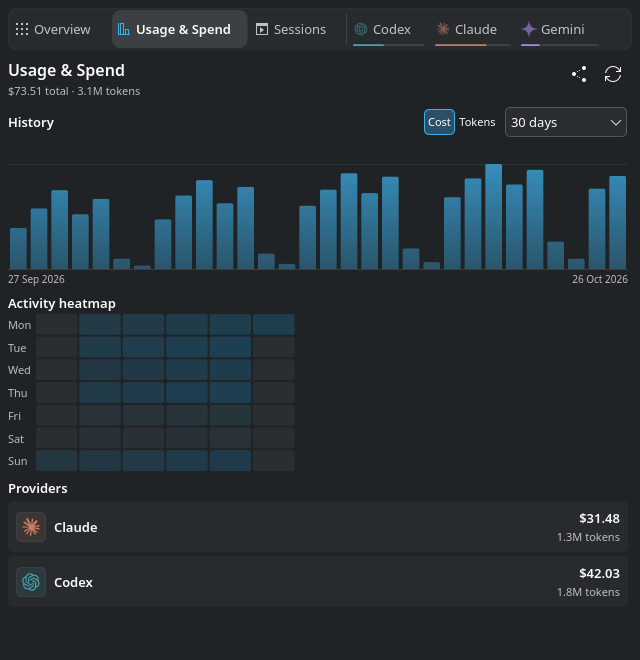
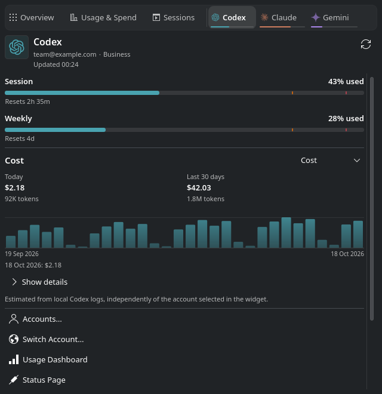

# CodexBar Plasma

Track Codex, Claude, Gemini, and 90+ more AI providers from your KDE Plasma 6
panel. Quotas, reset windows, costs, local agent sessions, notifications, and
multiple accounts per provider.

[Install](#install) · [Features](#features) · [Troubleshooting](#troubleshooting) · [Development](#development)



The current popup in Breeze Dark with synthetic data. The widget follows your Plasma
theme; provider accent colors stay consistent across themes.

## Install

### Quick install from a terminal

From a terminal in your Plasma 6 desktop session, run this as your regular user,
without `sudo`. Bash must be installed; your terminal can use another shell.

```sh
curl -fsSL -m 30 --max-filesize 65536 https://raw.githubusercontent.com/Lucenx9/codexbar-plasma/main/setup.sh | bash
```

This runs a small bootstrap from this repository's `main` branch. It downloads
the complete installer before running it and keeps prompts in your terminal.
It installs the latest stable **release package** for your user, with no Git
checkout or build. It reports missing command-line dependencies before
downloading the package. The [runtime requirements](#requirements) still apply.

1. If `codexbar` is absent from your terminal's PATH, setup offers to install or
   reuse a private official CLI. Answer `y` to prepare it now.
2. Add **CodexBar** to your panel through **Add Widgets**. If you prepared the
   private CLI and the popup reports that the CLI is missing, click **Install
   and use CLI**. This reuses the prepared copy offline and selects it immediately.
   You can also select **General → Managed CLI → Use managed CLI** in widget
   settings, then **Apply**.
3. Enable and configure your providers in the widget's **Providers** settings.

Existing CLI installations and provider credentials are preserved. Rerunning
the command upgrades an older widget and offers to restart Plasma. Prompts
default to No; without a terminal they are skipped.

<details>
<summary>Download verification, script inspection, and unattended setup</summary>

The installer verifies the package's GitHub SHA-256 digests, published checksum,
applet ID and version. The bootstrap keeps the downloaded installer in shell
memory. To inspect the bootstrap first, download the URL above to a file you
choose and run it with `bash FILE`. The full installer is
[`scripts/update-widget.sh`](https://github.com/Lucenx9/codexbar-plasma/blob/main/scripts/update-widget.sh),
which you can also download, inspect, and run with `bash FILE --setup`.

The interactive pipeline can return success if the initial download fails
without sending a script. For unattended or scripted setup, use this form to
report download failures with a nonzero exit status and suppress optional prompts:

```sh
bash -o pipefail -c 'curl -fsSL --connect-timeout 10 --max-time 30 --max-filesize 65536 --max-redirs 5 --proto "=https" --proto-redir "=https" https://raw.githubusercontent.com/Lucenx9/codexbar-plasma/main/setup.sh | bash -s -- --no-input'
```

Add `--with-cli` after `--no-input`, inside the quotes, to explicitly install
or reuse the private CLI too. Select it through **Install and use CLI** in the
missing-CLI popup, or through **Use managed CLI** in settings followed by **Apply**.
A CLI failure leaves the widget installed and returns a nonzero status.

</details>

### KDE Store or manual installation

1. Install the Linux CLI from the
   [official CodexBar release tarballs](https://github.com/steipete/CodexBar/releases/latest)
   or another method documented by [upstream CodexBar](https://github.com/steipete/CodexBar).
   Third-party packages such as AUR can lag behind upstream releases.
   Alternatively, install the widget first and click **Install and use CLI** in
   the missing-CLI popup. This installs or reuses a private official Linux binary
   and selects it immediately, without opening settings or pressing Apply.
   You can also use **General → Managed CLI →
   Install and select managed CLI**, then **Apply**. This downloads an official
   Linux binary to a private directory without replacing a system installation.
   If the CLI is missing, the popup shows this setup route even after switching
   to Usage & Spend or Sessions.
   Use the resolved path from **Diagnostics → Check versions** for terminal commands.
   Set up your provider using the upstream instructions, then verify usage:

   ```sh
   codexbar usage --format json --json-only
   ```

2. Install the widget. From your panel, open **Add Widgets → Get New Widgets →
   Download New Plasma Widgets**, search for **CodexBar**, and install it from
   the [KDE Store](https://store.kde.org/p/2370789/).

   Or download `codexbar-plasma.plasmoid` from the widget's
   [latest release](https://github.com/Lucenx9/codexbar-plasma/releases/latest)
   and run, in the directory containing that file:

   ```sh
   kpackagetool6 -t Plasma/Applet -i codexbar-plasma.plasmoid
   ```

   The GitHub release is the newest package; a store listing can trail it. The
   widget's own update check always follows GitHub releases.

3. Open your Plasma panel's **Add Widgets** chooser and add **CodexBar**.

4. Open the widget settings. Use **Providers** to enable providers and supported
   setup actions, **Panel** to adjust the compact display, and **General** to
   choose refresh and privacy settings.

Provider enable/disable and setup actions change the CLI configuration
immediately. **Apply** and **Cancel** cover widget settings only.

New widgets refresh quotas every five minutes, refresh again when you open the
popup on quotas older than that interval, and show percent **used**. Warning
and critical thresholds default to 80% and 95%. Existing settings are preserved
when you upgrade.

Failed refreshes retain quotas measured within the last 24 hours and identify
them as last known.
A redacted cache restores recent quotas after a Plasma restart while the CLI
refreshes. See [data freshness](https://github.com/Lucenx9/codexbar-plasma/blob/main/docs/usage.md#data-freshness)
for its limits.

## Requirements

- KDE Plasma 6, `kpackagetool6`, and the `org.kde.plasma.plasma5support` QML module.
- `QtQuick.Dialogs` and KDE Declarative's `org.kde.kquickcontrolsaddons` QML
  modules for the local usage-sharing window, file picker, and image clipboard.
- A working `codexbar` CLI, available on Plasma's `PATH` or through an absolute
  path configured in the widget, including its optional managed copy. Managed
  downloads support Linux x86_64/aarch64 with glibc or musl; the downloaded
  executable must pass a local version probe before activation.
- `notify-send` for Plasma notifications.
- Offline Diagnostics support-report collection: `python3` and GNU `timeout`.
  Other Diagnostics controls remain available without this report helper.
- Optional AI Insights only: `python3`, GNU `timeout`, and the `QtCore` QML
  module for its private snapshot handoff; for OpenRouter or
  OpenAI keys also `kdialog`, `secret-tool`, and a Secret Service provider such
  as KWallet. Nothing is required while the feature is off.
- Optional identified Codex token subtotals: `codexbar` 0.75.0 or later and GNU `timeout`.
  Including an SSH source also requires that CLI on the remote computer and
  working noninteractive SSH authentication with trusted host keys.
- `curl`, `jq`, `python3`, `sha256sum`, GNU `timeout`, and util-linux `flock` for
  the bundled release updater. CLI release checks and managed installs also use `python3` and GNU `timeout`. GNU `timeout`
  also bounds CLI writes after a secret prompt.

Distribution package names vary. Source builds also need `make`, Python
3, and GNU gettext; see [Development](#development).

## Features

Collect an offline support report in **Diagnostics**, review its preview, and
copy it into a bug report. It includes installed versions, selected/system CLI
paths and ownership, enabled provider IDs and module checks, with home usernames
and credentials redacted.

Share a local usage summary from **Usage & Spend** as a PNG or copied text.
The preview includes the selected history range, token totals, estimated usage
costs, providers, and top models, with a small repository attribution. See [usage sharing](https://github.com/Lucenx9/codexbar-plasma/blob/main/docs/usage.md#share-usage).

| Standard panel | Minimal panel |
| --- | --- |
| [](docs/codexbar-plasma-panel-standard.png) | [](docs/codexbar-plasma-panel-minimal.png) |

The same Codex, Claude, and Gemini usage in both styles. Small provider icons
sit beside primary and secondary quota capsules. Choose the appearance in
**Panel** settings. These examples show meters with panel text hidden.

| Provider overview | Local sessions |
| --- | --- |
| [](docs/codexbar-plasma-overview.png) | [](docs/codexbar-plasma-sessions.png) |
| **Usage & Spend** | **Provider details** |
| [](docs/codexbar-plasma-usage-spend.png) | [](docs/codexbar-plasma-codex.png) |

The popup captures are the full-size stills behind the animation above. Click an
image to open it. Panel captures show the capsule design released in 0.2.36;
popup captures show the current popup. All use Breeze Dark with synthetic data. The
widget follows your Plasma theme; provider accent colors stay consistent across
themes.

- Quota meters, reset windows, account selection, and provider status in the panel
  and popup, with configurable quota warnings and Plasma notifications.
- Standard and Minimal panel styles with up to two quota capsules per provider,
  horizontal and vertical meters, selectable quota windows, conditional text
  and meters, and a live settings preview that stays visible while scrolling.
  Optional text sits beside the selected
  provider's capsules with the default order. Panel settings keep appearance and
  meters visible; additional information and quota/order/visibility options expand
  when needed.
- **Usage & Spend** with cost/token charts, a 7/30/90-day, month-to-date, or
  all-history range, an activity
  heatmap, and provider, model, and project breakdowns when the CLI supplies them.
- An optional manual Codex identified-request token subtotal, with separate
  local and local + SSH actions, an independent UTC window, and partial-data
  notices. It is off by default and has no prices or account-wide coverage.
- A local **Sessions** tab. Transcript paths and working directories are never
  displayed or opened.
- Refresh on popup opening, plus optional privacy mode and automatic widget updates.
- Optional, off-by-default beta [AI Insights](https://github.com/Lucenx9/codexbar-plasma/blob/main/docs/usage.md#ai-insights):
  a short summary in Overview with an in-popup analysis view, from a local
  Ollama model, OpenRouter, or OpenAI,
  written in the widget's interface language from aggregated statistics only.
- English plus Italian, French, German, Spanish, and Brazilian Portuguese,
  selected through your Plasma language preferences.

Provider authentication and data support come from the CLI. The widget includes
per-provider source selection in **Providers → Settings and diagnostics** with
CLI 0.73.0 or later; the source override in Diagnostics takes precedence. It also includes
fallback metadata for all 106 providers in the official CodexBar 0.77.0 registry,
covering names, icons, and documentation links, with brand colors and dashboard
and status links where upstream defines them. Available metrics and setup
actions vary by provider. Command Code and fal offer single API-key setup with
CLI 0.75.0 or later, and Munito with CLI 0.77.0 or later. Future AGI setup
requires a secret-key writer that the official Linux CLI does not yet provide.
The proposed generic provider-settings descriptor is not available in CLI
0.77.0; its additional editors remain unavailable.

<!-- Web links to guides also work in the installed package, which omits those files. -->
See the [usage and settings guide](https://github.com/Lucenx9/codexbar-plasma/blob/main/docs/usage.md)
for options and defaults, the [documentation index](https://github.com/Lucenx9/codexbar-plasma/blob/main/docs/README.md)
for verified CLI evidence, and [Linux parity TODO](https://github.com/Lucenx9/codexbar-plasma/blob/main/TODO.md)
for remaining Linux/Plasma work.

## Update

Read the [changelog](CHANGELOG.md) for changes and upgrade notes by version.

To upgrade a release installation, download the new `.plasmoid` and run:

```sh
kpackagetool6 -t Plasma/Applet -u codexbar-plasma.plasmoid
```

Log out and back in to load the new widget code, or reload your Plasma panels
and desktop with:

```sh
systemctl --user restart plasma-plasmashell.service
```

In **General → Updates**, **Check for widget updates** and update notifications
are enabled by default. Checks run every 24 hours by default; restarting Plasma
respects the last successful check, while first use or an overdue check runs
immediately. Manual checks bypass the interval. Clicking an update notification
opens that release's page on GitHub where the installed `notify-send` supports notification actions.
**Install widget updates automatically** is opt-in.

The widget-update helper accepts only immutable GitHub releases. It binds assets to
the advertised tag, verifies SHA-256 digests and the published checksum, and
checks the applet ID and version before installation. A validation mismatch
aborts the update. Before upgrading, the helper backs up the installed widget
and restores it if installation fails or the installed metadata is invalid.

**General → CLI updates** offers a manual check of official CodexBar releases
and optional daily checks, off by default. Notifications can be enabled separately.
These announce upstream releases, not package-manager availability. AUR and other
package users should update through their existing package tools; the widget
never replaces their CLI. Recognized ownership includes pacman, dpkg, RPM, APK,
and Homebrew. Unrecognized installations keep their original update method.
**Diagnostics → Check versions** stays offline and reports the installed CLI,
resolved command, and recognized installation manager.

**General → Managed CLI** can install and select a separate private CLI, update
it immediately, or restore its previous version. An existing managed copy can be
selected offline with **Use managed CLI**. Custom data directories are resolved
before installation, including symbolic links and parent segments. Before a
first install, an offline probe identifies the selected CLI so a working external copy receives a
confirmation without needing a GitHub release check.
If the probe cannot identify the CLI, installation waits until **Retry** succeeds
or the selected command is confirmed missing. **Automatically update the
managed CLI daily** is optional and off by default; it acts only while the
managed command path is selected. Downloads match the host architecture/libc,
verify GitHub SHA-256 metadata and the published checksum, accept only bounded
expected archive entries (including the optional third-party notice), and
switch atomically after a version probe. A restored version stays selected
until a newer release arrives or you explicitly update again. See
[managed CLI details](https://github.com/Lucenx9/codexbar-plasma/blob/main/docs/usage.md#managed-cli).

For a source checkout, see the [development update commands](https://github.com/Lucenx9/codexbar-plasma/blob/main/docs/development.md#work-from-a-checkout).
The source-checkout helper `./install.sh` checks for `kpackagetool6` and
`systemctl` before building, then installs the package and restarts Plasma.

## Troubleshooting

### The widget stays on Loading or cannot find the CLI

Usage errors in the popup offer **Retry** and **Settings**. Open **Diagnostics**
in widget settings to check the connection. Retry is unavailable while a quota
refresh is running; the last known quotas stay visible when available.

If the popup says **CodexBar CLI not found**, Plasma could not run the
configured command at all. Click **Install and use CLI** to install or reuse a
private official CLI and start fetching usage immediately. Progress and failures
appear in the popup, where you can retry preparation or open **Settings**.
This leaves provider configuration and automatic-update preferences unchanged.
Existing private copies must pass an offline version check before reuse; a
damaged or incompatible copy shows an error instead of being selected again.
To use an existing external CLI, set its absolute path as described below.
**Diagnostics → Check versions** reports the widget and CLI
versions and the absolute command the shell resolved.

Run `codexbar usage --format json --json-only` in a terminal. If it fails,
resolve the provider or CLI setup first. If it works, locate the executable:

```sh
command -v codexbar
```

Paste the returned absolute path into **Diagnostics → Command path**. Plasma
may have a different `PATH` from your terminal. **Use PATH** restores the
portable `codexbar` default.

### Providers, accounts, or costs are missing

If the popup has no provider data, choose **Configure providers**, then open
**Providers** in widget settings to enable or set up a provider.

Check that the provider is enabled in **Providers**, then inspect the relevant
CLI response. For example, for Codex accounts and local cost data:

```sh
codexbar usage --provider codex --all-accounts --format json --json-only
codexbar cost --format json --json-only
```

The widget can display only data the CLI returns. Cost availability varies by
provider; missing dollar amounts do not mean zero spend. If a feature is absent,
check the [usage guide](https://github.com/Lucenx9/codexbar-plasma/blob/main/docs/usage.md)
and [Linux parity TODO](https://github.com/Lucenx9/codexbar-plasma/blob/main/TODO.md).

### Notifications do not appear

Check the widget's **Notifications** settings and test desktop notifications:

```sh
notify-send "CodexBar" "Notification test"
```

### Report a problem

[Open a widget issue](https://github.com/Lucenx9/codexbar-plasma/issues/new/choose)
and complete the form: reproduction steps, expected and actual behavior, your
distribution, and the Plasma, widget, and CLI versions. Report a suspected
vulnerability privately through the
[security policy](https://github.com/Lucenx9/codexbar-plasma/blob/main/SECURITY.md)
instead of opening an issue. For QML errors, inspect recent logs:

```sh
journalctl --user -u plasma-plasmashell.service --since '10 minutes ago' --no-pager
```

Include only relevant CodexBar errors. Redact account details, paths, credentials,
and other personal information before sharing logs or screenshots. If the CLI
command itself fails, consult [upstream CodexBar](https://github.com/steipete/CodexBar)
for provider setup and CLI support.

## Development

Build and install from a checkout:

```sh
git clone https://github.com/Lucenx9/codexbar-plasma.git
cd codexbar-plasma
make install
```

Then reload Plasma as described under [Update](#update).
Run `make check` before submitting changes. The
[development guide](https://github.com/Lucenx9/codexbar-plasma/blob/main/docs/development.md)
covers dependencies, checks, isolated popup smoke tests, packaging, and QML
conventions. See the [documentation index](https://github.com/Lucenx9/codexbar-plasma/blob/main/docs/README.md)
for maintained references.

Contributions to the Plasma widget are welcome through
[pull requests](https://github.com/Lucenx9/codexbar-plasma/pulls). Read
[CONTRIBUTING.md](https://github.com/Lucenx9/codexbar-plasma/blob/main/CONTRIBUTING.md)
first and include the verification results requested by the PR template. Provider logic and CLI
contracts belong upstream. To add or improve a language, follow the
[translation guide](https://github.com/Lucenx9/codexbar-plasma/blob/main/docs/translations.md).
CLI-supplied free-form text retains its original language.

## Support

If CodexBar Plasma saves you time, you can
[support development on Ko-fi](https://ko-fi.com/lucenx9). The same link is in
the repository's **Sponsor** button.

## License and attribution

CodexBar Plasma is a standalone frontend for the official
[CodexBar CLI](https://github.com/steipete/CodexBar). The widget code is
distributed under the [MIT License](LICENSE). Bundled provider artwork includes
upstream CodexBar assets and a Poe icon under CC BY 4.0. See
[NOTICE.md](NOTICE.md) for sources, licenses, and attribution.
