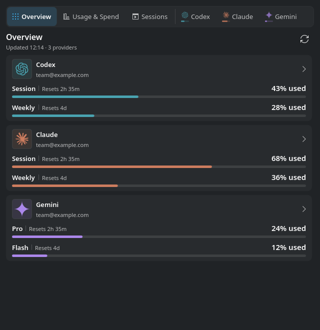
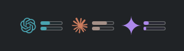
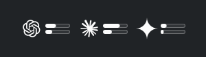

# CodexBar Plasma

A standalone KDE Plasma 6 widget for the official
[CodexBar CLI](https://github.com/steipete/CodexBar). Monitor quotas, reset times,
costs, and local agent sessions for Codex, Claude, Gemini, and other providers
from your panel.

Available data and setup actions depend on the provider and the Linux CLI.

[Install](#install) · [Requirements](#requirements) · [Features](#features) · [Update](#update) · [Troubleshooting](#troubleshooting) · [Development](#development) · [AI agents](https://raw.githubusercontent.com/Lucenx9/codexbar-plasma/main/llms.txt)



The tour uses Breeze Dark and synthetic data. The widget follows your Plasma theme.

## Requirements

- KDE Plasma 6, `kpackagetool6`, and the `org.kde.plasma.plasma5support` QML module.
- A working `codexbar` CLI on Plasma's `PATH` or an absolute path selected in
  the widget. You can install a private official copy during setup. Managed
  downloads support Linux x86_64 and aarch64 with glibc or musl.
- For the terminal installer and widget updater: Bash,
  `curl`, `jq`, `python3`, `sha256sum`, GNU `timeout`, and util-linux `flock`.

Distribution package names vary. Source builds also need `make`, Python 3,
and GNU gettext; see [Development](#development).

<details>
<summary>Dependencies for individual features</summary>

| Feature | Dependencies |
| --- | --- |
| Plasma notifications | `notify-send` |
| Usage sharing, file picker, and image clipboard | `QtQuick.Dialogs` and KDE Declarative's `org.kde.kquickcontrolsaddons` QML modules |
| Terminate hung background CLI reads and bound writes after a secret prompt | GNU `timeout` |
| Offline support reports | `python3` and GNU `timeout` |
| Service status components | `python3` and GNU `timeout`; optional `curl` avoids slow IPv6 connection fallback |
| Manual cookies and credential clearing | CLI 0.82.0 or later (0.83.0 for OpenDesign; 0.84.0 for WorkBuddy), `python3`, GNU `timeout`; `kdialog` for cookies |
| Claude Platform validated session import | CLI 0.84.0 or later, `python3`, GNU `timeout`, and `kdialog` |
| Copilot GitHub device sign-in | CLI 0.80.0 or later, `python3`, GNU `timeout`, and `kdialog` |
| CLI release checks and managed installs | `python3` and GNU `timeout` |
| AI Insights | `python3`, GNU `timeout`, and the `QtCore` QML module |
| AI Insights keys for OpenRouter or OpenAI | Also `kdialog`, `secret-tool`, and a Secret Service provider such as KWallet |
| Identified Codex token subtotals | CLI 0.75.0 or later with identified-token schema 1 or 2, and GNU `timeout` |
| Refresh as soon as the network connection returns | Qt 6.7 or later with the `QtNetwork` QML module |
| SSH source for identified Codex tokens | Also the CLI on the remote computer and noninteractive SSH authentication with trusted host keys |

Without GNU `timeout`, background CLI reads still work, but canceling a request
cannot terminate a hung process. Without the support-report or status helpers,
other Diagnostics controls and links to status pages remain available.
AI Insights is off by default and needs no helper dependencies while disabled.

</details>

## Install

### Quick install from a terminal

In your Plasma 6 desktop session, run this command as your regular user, without `sudo`.
Bash must be installed; your terminal can use another shell.

```sh
bash -o pipefail -c 'curl -fsSL --connect-timeout 10 -m 30 --max-filesize 65536 --max-redirs 5 --proto "=https" --proto-redir "=https" https://raw.githubusercontent.com/Lucenx9/codexbar-plasma/main/setup.sh | bash'
```

The command downloads the installer from this repository's `main` branch and
installs the latest stable widget release. You do not need a Git checkout or build.
The installer reports missing dependencies before downloading the package.

If the installer offers a private official CLI, answer `y` to prepare it.
Existing CLI installations and provider credentials are preserved.
Then [set up the widget](#set-up-the-widget).

Run the command again to upgrade. The installer offers to restart Plasma.
Optional prompts default to No and are skipped without a terminal.
Download failures return a nonzero exit status.

### Set up the widget

After installing through any method:

1. Open your panel's **Add Widgets** chooser and add **CodexBar**.
2. If the popup reports **CodexBar CLI not found**, click **Install and use CLI**.
   This installs or reuses a private official CLI and selects it immediately.
   To select an existing CLI, enter its absolute path in **Diagnostics → Command path** and apply.
3. Open **Providers** in widget settings and enable the providers you want.
   Use the available setup actions or follow each provider's **Docs** link for authentication.

The popup shows quotas when the CLI returns usage.
Provider enablement and credential actions save immediately to the CLI configuration.
To change a provider's source mode, select the source and click **Save**.
**Apply** and **Cancel** cover widget settings only.

For provider requirements, see
[provider setup](https://github.com/Lucenx9/codexbar-plasma/blob/main/docs/usage.md#providers-and-accounts).
For other CLI installation methods, see the
[upstream instructions](https://github.com/steipete/CodexBar).

<details>
<summary>Inspect the installer or run unattended setup</summary>

To inspect the installer before running it, download
[`setup.sh`](https://github.com/Lucenx9/codexbar-plasma/blob/main/setup.sh)
to a file. Read it, then run `bash FILE`.
The bootstrap downloads the complete
[`scripts/update-widget.sh`](https://github.com/Lucenx9/codexbar-plasma/blob/main/scripts/update-widget.sh)
before running it. You can also inspect the full installer and run
`bash FILE --setup`.
The installer verifies the package's GitHub SHA-256 digests, published checksum,
applet ID, and version.

For unattended or scripted setup, use this form to suppress optional prompts:

```sh
bash -o pipefail -c 'curl -fsSL --connect-timeout 10 --max-time 30 --max-filesize 65536 --max-redirs 5 --proto "=https" --proto-redir "=https" https://raw.githubusercontent.com/Lucenx9/codexbar-plasma/main/setup.sh | bash -s -- --no-input'
```

Add `--with-cli` after `--no-input`, inside the quotes, to install or reuse the
private CLI too. To select the prepared copy, use **General → Updates → CodexBar CLI → Managed CLI →
Use managed CLI** in widget settings, then **Apply**.
A CLI preparation failure leaves the widget installed and returns a nonzero status.

</details>

<details>
<summary>KDE Store or manual installation</summary>

### KDE Store or manual installation

Choose either installation method, then [set up the widget](#set-up-the-widget).

#### KDE Store

From your panel, open **Add Widgets → Get New Widgets → Download New Plasma
Widgets**, search for **CodexBar**, and install it from the
[KDE Store](https://store.kde.org/p/2370789/).

#### Manual package

Download `codexbar-plasma.plasmoid` from the
[latest widget release](https://github.com/Lucenx9/codexbar-plasma/releases/latest).
In the directory containing that file, run:

```sh
kpackagetool6 -t Plasma/Applet -i codexbar-plasma.plasmoid
```

A store listing can trail the GitHub release. The widget's updater follows GitHub.

</details>

## Features

- Quota meters, reset times, multiple accounts, provider status, and configurable notifications.
- **Provider colors** or **Monochrome** panel styles, quota capsules or rings, optional text, and spend budgets.
  Preview changes in **Panel** settings.
- **Usage & Spend** with cost and token history, provider filters, model
  breakdowns and cross-provider rankings, weekly comparisons, and an optional
  activity calendar.
- Local agent **Sessions**, with no transcript paths or working directories displayed or opened.
- Usage summaries to save as PNG images or copy as text, plus a privacy mode to hide personal information.
- Optional beta
  [AI Insights](https://github.com/Lucenx9/codexbar-plasma/blob/main/docs/usage.md#ai-insights)
  from Ollama, OpenRouter, or OpenAI. Ask questions about your usage
  in **Usage & Spend**. AI Insights is off by default and uses only aggregated statistics.
- English, Italian, French, German, Spanish, and Brazilian Portuguese, selected
  through your Plasma language preferences.

Bundled names and icons cover all 113 providers in official CLI 0.84.0.
Newer providers use generic presentation where needed. See the
[usage guide](https://github.com/Lucenx9/codexbar-plasma/blob/main/docs/usage.md)
for options, defaults, and data limits.

| Provider colors panel | Monochrome panel |
| --- | --- |
| [](docs/codexbar-plasma-panel-standard.png) | [](docs/codexbar-plasma-panel-minimal.png) |

Both styles show the same usage with panel text hidden.
In **Panel → Appearance**, choose **Rings** to put quota indicators around each icon.

[](docs/codexbar-plasma-panel-rings.png)

All images use synthetic data. Percentages show quota **used**.
If a refresh fails, the widget can show last known quotas for up to 24 hours. See
[data freshness](https://github.com/Lucenx9/codexbar-plasma/blob/main/docs/usage.md#data-freshness)
for cache limits.

<!-- Web links to guides also work in the installed package, which omits those files. -->
The [documentation index](https://github.com/Lucenx9/codexbar-plasma/blob/main/docs/README.md)
links more screenshots and verified CLI evidence.
[Linux parity TODO](https://github.com/Lucenx9/codexbar-plasma/blob/main/TODO.md)
tracks remaining work and upstream blockers.

## Update

Widget updates are checked and installed automatically every 24 hours by default.
To opt out, clear **General → Updates → Widget updates → Install automatically** and apply.
The automatic updater never restarts Plasma.

To update manually, download the new `.plasmoid` from the
[latest widget release](https://github.com/Lucenx9/codexbar-plasma/releases/latest)
and run in its directory:

```sh
kpackagetool6 -t Plasma/Applet -u codexbar-plasma.plasmoid
```

After an update, log out and back in, or restart your Plasma panels and desktop:

```sh
systemctl --user restart plasma-plasmashell.service
```

The updater verifies the release and backs up the installed widget.
A failed upgrade restores the previous package. See
[update settings](https://github.com/Lucenx9/codexbar-plasma/blob/main/docs/usage.md#update-the-widget)
for controls and how defaults apply to older installations.
Read the [changelog](CHANGELOG.md) for release notes.

CLI updates are separate. Update an external CLI through its original installation method.
The private managed CLI updates daily by default while selected. Manage its updates,
selection, and rollback under **General → Updates → CodexBar CLI → Managed CLI**.
See [managed CLI settings](https://github.com/Lucenx9/codexbar-plasma/blob/main/docs/usage.md#managed-cli)
for details.

## Troubleshooting

### The widget stays on Loading or cannot find the CLI

Use **Retry** in the popup or open **Diagnostics** in widget settings.
**Check versions** reports the widget and CLI versions and the resolved CLI path.
If the CLI is missing, click **Install and use CLI** to prepare a private copy.

To check an existing CLI, run this in a terminal:

```sh
codexbar usage --format json --json-only
```

If it fails, resolve the provider or CLI setup first. If it works, locate it:

```sh
command -v codexbar
```

Paste the returned absolute path into **Diagnostics → Command path** and apply.
Plasma may have a different `PATH` from your terminal. **Use PATH** restores the
`codexbar` default. For a managed copy, use the resolved path from
**Diagnostics → Check versions** in terminal commands.

### Providers, accounts, or costs are missing

If the popup has no provider data, choose **Configure providers** and enable or
set up a provider. Check the relevant CLI response, for example:

```sh
codexbar usage --provider codex --all-accounts --format json --json-only
codexbar cost --format json --json-only
```

The widget displays only data the CLI returns. Missing dollar amounts do not
mean zero spend. See the
[provider setup and compatibility notes](https://github.com/Lucenx9/codexbar-plasma/blob/main/docs/usage.md#providers-and-accounts)
for version requirements and known CLI issues.

### Notifications do not appear

Check **Notifications** in widget settings and test desktop notifications:

```sh
notify-send "CodexBar" "Notification test"
```

### Report a problem

[Open a widget issue](https://github.com/Lucenx9/codexbar-plasma/issues/new/choose)
and complete the form. Include reproduction steps, expected and actual behavior,
your distribution, and the Plasma, widget, and CLI versions. You can collect a
redacted offline support report in **Diagnostics** and review its preview first.
Report suspected vulnerabilities privately through the
[security policy](https://github.com/Lucenx9/codexbar-plasma/blob/main/SECURITY.md).

For QML errors, inspect recent logs:

```sh
journalctl --user -u plasma-plasmashell.service --since '10 minutes ago' --no-pager
```

Include only relevant CodexBar errors. Redact account details, paths, credentials,
and other personal information before sharing logs or screenshots.
If the CLI command itself fails, consult
[upstream CodexBar](https://github.com/steipete/CodexBar) for CLI support.

## Development

Install the build dependencies listed under [Requirements](#requirements), then:

```sh
git clone https://github.com/Lucenx9/codexbar-plasma.git
cd codexbar-plasma
make install
```

Restart Plasma as described under [Update](#update).
Before submitting changes, read
[CONTRIBUTING.md](https://github.com/Lucenx9/codexbar-plasma/blob/main/CONTRIBUTING.md)
and run `make check`. See the
[development guide](https://github.com/Lucenx9/codexbar-plasma/blob/main/docs/development.md)
for test dependencies, packaging, and runtime verification, or the
[translation guide](https://github.com/Lucenx9/codexbar-plasma/blob/main/docs/translations.md)
to improve a language. Provider logic and CLI contracts belong upstream.

## Support

If CodexBar Plasma saves you time, you can
[support development on Ko-fi](https://ko-fi.com/lucenx9). The same link is in
the repository's **Sponsor** button.

## License and attribution

CodexBar Plasma is a standalone frontend for the official
[CodexBar CLI](https://github.com/steipete/CodexBar). The widget code is
distributed under the [MIT License](LICENSE). Bundled provider artwork includes
upstream CodexBar assets and a Poe icon under CC BY 4.0. See
[NOTICE.md](NOTICE.md) for sources, licenses, and attribution.
