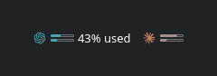
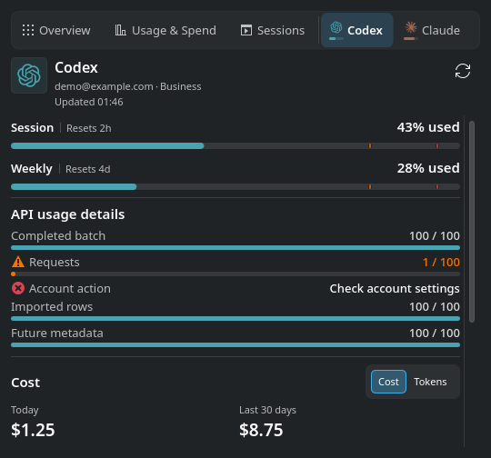
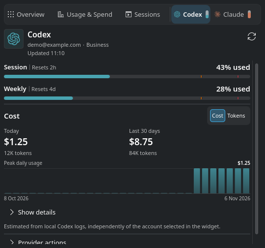
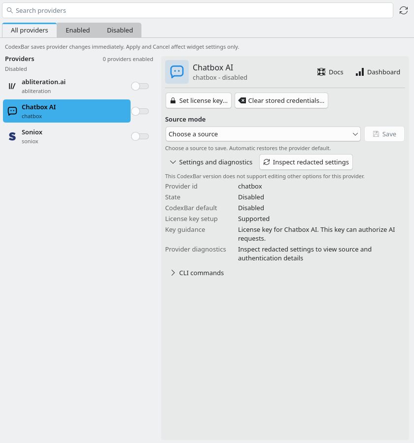
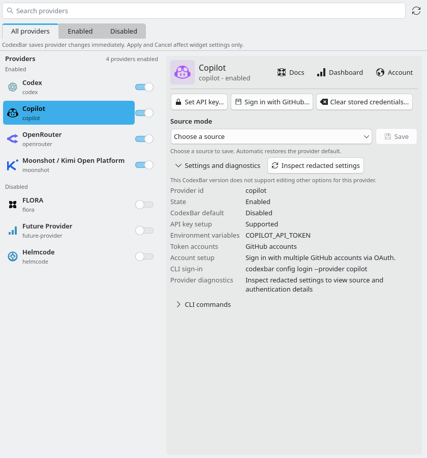
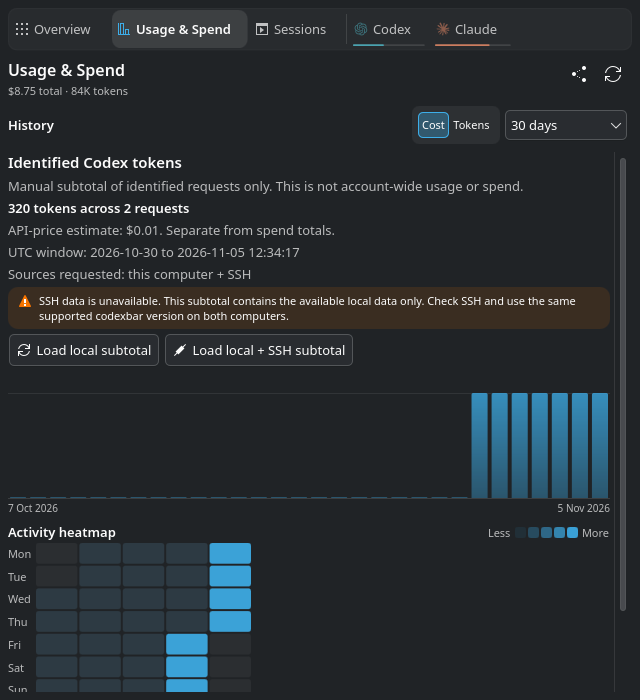
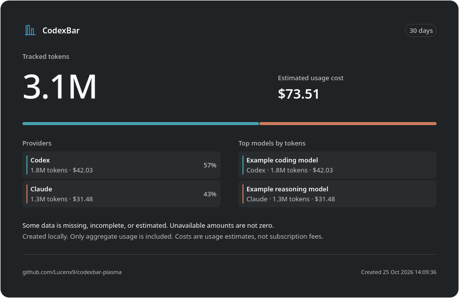
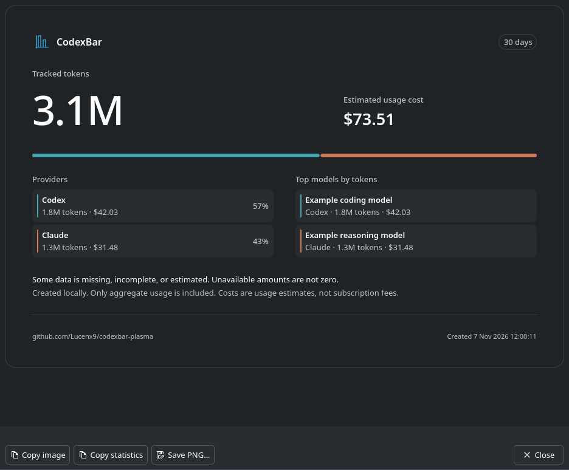

# Using CodexBar Plasma

See the [README](../README.md#install) for installation and first setup. This
guide covers the widget's controls, provider setup, history, privacy, and
updates. Available data and actions depend on the selected official CLI.

- [Panel and popup](#panel-and-popup)
- [Data freshness and recovery](#data-freshness)
- [Providers and accounts](#providers-and-accounts)
- [Costs, identified tokens, and sharing](#costs-and-history)
- [Status and notifications](#status-and-notifications)
- [Settings and updates](#settings)
- [AI Insights](#ai-insights)
- [Defaults](#default-settings)

The [documentation index](README.md) links technical contracts and pinned CLI
evidence. [TODO.md](../TODO.md) tracks remaining Linux/Plasma parity work.

## Panel and popup

### Choose panel content

Open **Panel** in widget settings. The live preview uses synthetic data and
never fetches usage. Its **Example** selector shows normal usage, near-limit
usage, an incident, or missing data. **Apply** saves your changes.

- **Provider colors** uses provider colors; **Monochrome** uses the Plasma
  text color. Warning and critical colors remain independent for each quota.
- **Meter shape** chooses **Capsules** or **Rings**, independently of color.
  Automatic meters show primary and secondary quotas together when available;
  an explicit quota choice shows one meter. Missing quotas are omitted and
  measured zero leaves an empty track.
- **Show only icons and meters** selects Monochrome, enables provider meters,
  and hides names, usage text, credits, and spend budgets. It keeps your meter
  shape and quota choice.
- **Additional information** enables the selected provider's name, usage text,
  credit balance, or spend budget. These work in horizontal panels; meters
  also work in vertical panels. Text format appears when usage text is enabled.
  Hiding an option keeps its saved value.
- **Panel providers** limits panel content to a chosen set of up to four
  enabled providers. **Use all enabled providers automatically** follows the
  enabled roster. Clearing every checkbox leaves only the widget icon.
  Disabled providers keep their saved selection without occupying a slot.
  When more than four selected providers become enabled, their saved order
  determines which four appear. Popup providers and notifications are unaffected.

Click a provider's icon, meter, or grouped text, or activate it with the
keyboard, to open that provider. Hover its icon for a provider-specific tooltip;
hover elsewhere for the panel roster. If every meter is hidden, the identity
icon remains available. With no panel provider selected, the widget icon toggles
the popup without changing its tab.

Panel text stays with its provider's meters in the default order. When space
runs out, less important text disappears first; usage and the identifying name
for a generic provider icon take priority. The tooltip, accessible description,
and popup keep the complete reading.

### Select quotas and visibility

Expand **Panel → Quota, order and visibility** to choose a quota, reorder panel
elements, set visibility conditions, or enable automatic provider selection.

**Automatic** shows the primary/secondary meter pair and chooses one quota for
panel text. For fresh authoritative readings, exhausted windows take priority,
followed by CLI forecasts of exhaustion, shortest time first. Otherwise the
provider's normal quota preference applies. An explicit primary, secondary,
or tertiary choice applies to both text and its single meter.

Panel text can show percent used or left, pace, usage with pace, reset time, or
the predicted time to exhaustion. A run-out duration appears only when the CLI
expects exhaustion before reset. **Name the quota chosen by Automatic** adds
its caption when several windows are available; it never changes selection.

Visibility conditions can apply independently to text and each provider's
meters: always, minimum percent used, reset within a chosen number of minutes,
or forecast exhaustion before reset. Either displayed quota can keep a meter
pair visible. Missing or unverified data cannot satisfy a condition; valid
reset conditions update each minute.

**Auto-select highest-usage provider** selects the highest measured consumption.
An incident breaks equal-consumption ties, followed by saved provider order.
It respects your panel provider set.

**Spend budget** shows a monetary allowance such as `Spend $12.00 / $20.00` when
the selected provider supplies one. Plain prepaid balances and retained or
private data supply no spend meter. Each provider keeps its own currency.

### Navigate the popup

The popup provides **Overview**, **Usage & Spend**, **Sessions**, and provider
tabs. A widget fixed to one provider omits global tabs. Provider tabs show
quotas, resets, account and plan information, credits, service status, and
optional provider details. Subscription renewal and expiration dates, when
supplied by the CLI, are separate from quota resets.

A failed provider tab stays dimmed until selected, hovered, or keyboard-focused.
Releasing a tab or Overview row outside its bounds cancels activation; moving
back inside before release restores its pressed feedback.

- Left and Right move focus between tabs and wrap at either end. Home and End
  select the first and last focus position. Enter or Space opens the focused tab.
  Arrow direction follows visual order in right-to-left layouts.
- Scroll buttons reveal overflowing tabs. Full labels and values appear in
  tooltips when abbreviated; icon actions also show their labels on keyboard focus.
- **Provider actions** expands accounts, provider links, and widget commands.
  It starts collapsed and closes when the provider or account changes.
- **Popup → Overview providers** chooses automatic selection of the first three
  eligible providers or a manual set of up to three. Disabled providers keep
  their choices without occupying a slot. The Overview header identifies a
  subset, such as **3 of 20 providers**. Provider order is set on the same page.

Overview shows each provider's primary and secondary quotas separately, so a
low session reading cannot hide an exhausted weekly window. Cursor can also
show its included-plan meter after the total quota is exhausted. Panel quota
selection does not change Overview.

**Popup** independently controls pace forecasts, credits/reset credits, and
additional provider details. These display choices do not change fetching,
panel metrics, or alerts. A plain credit balance has no allowance meter; a
Codex monthly credit meter requires a CLI-reported allowance. Reset credits
use the CLI's usable inventory so expired or redeemed credits are not counted.

**Show remaining monthly quota per day** divides the remaining percentage by
local calendar days until reset. A 60%-used quota resetting in ten days shows
`4.00% per day until reset`. This is an even allocation, separate from pace.
It requires a fresh measured 28–31-day window and a future reset timestamp.
Missing, estimated, unknown, or retained data shows no daily allowance.

**Show reset times as clock time** uses your regional date and clock format.
Resets within six days show weekday and time; later resets show date and time.
Otherwise resets use relative countdowns. Invalid reset dates never become
invented countdowns.

### Read confidence and provider details

Estimated quota percentages say **estimated** and show a `~` badge on panel
meters. Unknown confidence shows `?` and an unverified-quota label.
Percentage-only sources show plain percentages and explain their limitation
once in the tooltip. Explicit CLI resets and pace forecasts remain available
for those sources; absent resets read **Reset unavailable**.

These incomplete readings do not drive quota warning colors, threshold
markers, quota/pace/reset notifications, consumption-based provider ranking,
or conditional panel visibility. Provider service status remains independent.
Estimated and unknown-confidence readings also omit pace and reset details.
The [Claude detail contract](research/2026-10-15-claude-details-0.76.0.md)
records the verified percentage-only behavior.

Provider details can include spend, requests, tokens, models, labeled rows,
and inspectable charts. A CLI-reported **warning** or **critical** row has a
severity symbol and colors its value independently of the progress meter.
A meter needs a reported used/total pair. Privacy mode hides free-form details;
they are not restored from the quota cache.

To hide a quota row, use the button beside its percentage on hover or keyboard
focus. **Hidden usage rows → Restore** brings it back immediately. Hiding
affects only that provider tab; fetching, notifications, the panel, and Overview
still use the quota. Credits use their separate Popup option. Up to 64 quota
choices can be saved; restore one to make room when the hide button disappears.

Titled detail sections have the same hide action. **Hidden detail sections**
restores a current section. Equal titles hide together; renamed sections appear
again. Privacy mode also hides this restore list.

**Popup → Hidden items** lists both kinds of saved choices. A usage-row restore
affects that row; **Hidden detail sections → Restore all** restores all saved
sections for a provider, including sections no longer returned. Settings-page
restores take effect on **Apply**; **Cancel** discards them. Popup changes remain
immediate even while settings are open.

### Inspect usage and spend

**Usage & Spend** combines local history across providers. Select a provider,
**Cost** or **Tokens**, and a range: 7, 30, or 90 days, **Month to date**, or
**All history**. Currencies stay separate. **Expand analysis** places chart and
provider totals side by side; **Compact analysis** restores the stacked view.

Hover or use arrow keys on a chart to inspect a day. Click or use keyboard
selection to pin that day for provider/model details. Headline totals still
cover the whole period. **All days** or Escape clears selection. Inspection
reuses loaded data and starts no scan.

Click a provider row to expand its models without changing the provider filter
or leaving the tab. Models are ranked by the selected metric. The first three
appear initially; **Show more models** reveals the rest of the available list,
up to six. Missing or truncated breakdowns are identified. Expanded choices
survive refreshes and day selections. Project breakdowns stay in provider tabs.

**Daily activity** opens the calendar for ranges longer than seven days. It
follows the same provider, metric, and period filters. Measured zero is a recorded,
selectable day; an unavailable day is empty. Its key shows the intensity scale.
When the whole range does not fit, a note names how many recent days are shown;
the chart still covers the full range.

The calendar is one Tab stop. Left/Right moves between weeks on the same weekday,
mirrored for right-to-left layouts; Up/Down moves within a week. Home/End selects
the first/last visible measured day. Enter or Space pins a day and Escape clears
it. The readout below the grid shows the inspected date and amount.

**Last 7 days vs previous 7** excludes today and requires fourteen complete days
plus a scan from today. Missing, partial, stale, or ambiguous history shows
unavailable, with its requirements below the totals. An incomplete price list
can still allow a complete token comparison. No currencies are converted.

Current quotas stay in Overview and provider tabs. If both history sources are
disabled and AI Insights is enabled, Usage & Spend opens the assistant directly.
See [Costs and history](#costs-and-history) for scan timing and qualifications.

### Inspect sessions

**Sessions** shows local projects, session names, provider/source, state, and
activity age. Host names appear only when multiple hosts are present. Transcript
paths and working directories are never rendered or opened. Hover a card for
its copy action; privacy mode disables copying and hides personal names.

The tab rescans while visible every 30 seconds, or at the usage refresh interval
when shorter, even if periodic usage refresh is off. A failed scan keeps the
previous list and timestamp and waits for the same retry interval. Its refresh
button retries immediately. A successful empty scan clears the list.

The header's total and active count describe the loaded, bounded snapshot,
rather than a census of every session on the machine. Active includes running
and working states. The widget inspects at most 128 records; unreadable results
show an error without replacing a valid previous list.

## Data freshness

Usage refreshes on the configured interval. **General → Refresh when opening
the popup**, on by default, refreshes quotas older than that interval, or five
minutes when periodic refresh is off. Repeated opening and failed attempts
respect that cooldown. **Retry** requests usage and a fresh provider list,
without scanning costs or sessions; it is unavailable during a refresh.

When no providers are enabled, choose **Configure providers** and open
**Providers** in settings. If the CLI cannot run, **CodexBar CLI not found**
offers **Install and use CLI**, which prepares and selects a private official
copy immediately. Use **Settings → Diagnostics** to choose an external path.
Opening settings alone does not change the command or run diagnostics.

Network failures keep the provider's error visible with connection guidance.
When the QtNetwork QML module is available, the widget refreshes shortly after
an internet route returns; local sources continue refreshing offline. Without
that module, refreshes follow the configured interval.

### Last known quotas

A failed refresh keeps valid quotas for up to 24 hours. The popup and tooltip
say **Last known usage** with the measurement's age, and panel meters dim.
Healthy providers update independently. A failure naming a different account
cannot reuse the old account's quotas. A successful response without a quota
removes its previous value; measured zero stays zero.

Retained quotas do not drive quota, pace, reset, or status notifications, and
their forecasts are hidden. Newly fetched service status remains independent
and can still announce an incident. Supplemental credits, costs, subscription
dates, and free-form details are hidden while quotas are retained. The 24-hour
limit is a widget retention policy, not a guarantee of accuracy.

The widget saves a small quota-only cache for restart recovery. It verifies the
CLI configuration fingerprint before restoring it, and restored quotas always
read as last known until refreshed. The cache contains percentages, confidence,
timestamps, and quota identifiers, but no account identities, credentials,
provider prose, cost history, sessions, or paths. Entries older than 24 hours
are ignored. Fresh startup results take precedence over cached values.

Explicit account selections last for the current session. Their providers are
excluded from the restart cache so selected-account quotas cannot reappear as
default-account quotas. Other providers continue to be saved and restored.

Changing the CLI path, provider/source override, provider configuration, or
selected account invalidates the affected retained data. Disabling all providers
or confirming an empty aggregate provider response clears the relevant cache.
Privacy mode keeps the last-known indication visible.

Commands have UI deadlines. GNU `timeout` additionally stops hung CLI process
groups; without it, the UI can reject a late result but cannot stop the process.
See [implementation contracts](implementation.md#behavioral-contracts-to-preserve)
for lifecycle and cache bounds.

## Providers and accounts

Open **Providers** to search by name or ID and filter **All**, **Enabled**, or
**Disabled**. Clearing filters never changes provider configuration. Failed
list reloads preserve the last loaded list; **Reload** retries. Changing the
CLI path clears results from the previous executable.

Bundled icons cover all 113 providers in official CLI 0.84.0. New providers use
a generic icon; available data and setup still depend on Linux CLI support.

**Provider enablement, credentials, and source saves take effect immediately.**
Widget **Apply** and **Cancel** do not undo them. Secret prompts use the native
password dialog and CLI stdin. Credentials never enter widget settings,
command arguments, displayed errors, or logs. An idle secret prompt closes after
about 15 minutes; you can reopen it.

If you use user provider plugins, update CLI 0.65.0 to at least 0.66.0 before
disabling a provider: the older command drops their entries and stored secrets.

### Select accounts and sources

Use **Accounts…** or the account reload action to discover accounts. Up to three
choices appear inline; longer lists use the **Accounts** disclosure. Selecting
one changes displayed usage, not your underlying Codex login. **Use default
account** returns to the CLI default if a selected account disappears.

A provider without token-account support disables **Accounts…** and explains the
limit. Its reload action can retry. If no named accounts exist, the popup says
that the provider default is in use. Changing CLI/provider/source configuration
enables discovery again. Local cost history is independent of account selection.

With CLI 0.73.0 or later, choose **Providers → Settings and diagnostics → Source
mode**, then **Save**. Source choices come from the CLI when available; older
inventories use the legacy choices and let the CLI reject unsupported modes.
Automatic clears the saved override. Saving preserves enablement and credentials.
A source choice is a draft until **Save**, independently of widget Apply/Cancel.
If reading the saved mode fails, **Reload** retries and keeps the last confirmed
value visible. Older or unrecognized CLI versions omit this editor.

The global **Diagnostics** source override takes precedence for widget requests.
Listed source modes describe CLI configuration, not guaranteed Linux availability.
Under **Diagnostics**, an empty provider override requests enabled providers;
`both` requests Codex and Claude; `all` requests every discovered provider,
including disabled ones. A single provider ID limits the widget to that provider.

Gemini Automatic is broken on Linux CLI 0.77.0 through 0.80.0. Update to 0.81.0
or later, or save **API** as a workaround. Switch back to Automatic after the
update; the widget never rewrites that saved source for you.

### Set credentials

Actions appear only for known supported setups and recognized CLI versions.
When the CLI advertises authentication capabilities, those can further restrict
writes. Environment-variable names and CLI command hints appear under
**Settings and diagnostics** without reading their values. A listed variable may
be optional; check the provider's **Docs** link.

| Provider/action | CLI requirement | Requirement or limitation |
| --- | --- | --- |
| Fireworks API key | 0.54.0 | CLI must discover the account slug from the key. |
| Tavily, Linkup, Aerostack, Sail Research, Sofya API key | Verified at 0.74.0 | Single-key setup through the CLI. |
| Command Code, fal API key | 0.75.0 | fal needs billing read access; Command Code Automatic chooses API when a key is saved. |
| Munito API key | 0.77.0 | Admin key with Read account data permission. |
| Soniox API key | 0.80.0 | Organization key, `SONIOX_ORG_API_KEY`, rather than a project key. |
| abliteration.ai API key | 0.81.0 | `ABLITERATION_API_KEY`. |
| Chatbox AI license key | 0.81.0 | **Set license key…** takes `CHATBOX_LICENSE_KEY`, which can also authorize AI requests. |
| SiliconFlow, Tripo API key | 0.84.0 | SiliconFlow defaults to its China origin; international origin still needs external `SILICONFLOW_BASE_URL` configuration. |
| Manual cookie and credential clearing | 0.82.0 | Provider-specific cookie allowlist below; clearing is available for any listed provider. |
| Claude Platform validated session import | 0.84.0 | Requires a Console Cookie header containing `sessionKey`; the CLI validates before saving. |
| Copilot GitHub device sign-in | 0.80.0 | Requires `python3`, GNU `timeout`, and `kdialog`. |

This table calls out provider-specific requirements; other supported single-key
actions appear directly in settings. Exa and Cosmic AI need additional key/project
IDs; FLORA needs a workspace ID; Future AGI needs both `FI_API_KEY` and
`FI_SECRET_KEY`. Their incomplete Linux writers provide no key setup action.
Scoped checks through CLI 0.84.0 find no generic settings descriptors, so
additional base URL, workspace/project, region, and similar editors remain
unavailable. The [descriptor proposal](cli-provider-settings-descriptor.md)
describes an unshipped contract.

**Set cookie…** is supported with CLI 0.82.0 or later for Claude, Claude Platform,
Command Code, Cursor, Mistral, Ollama, OpenCode Go, Parallel, Raycast, TinyApi,
Trae CN, TypeSafe, and X API. OpenDesign requires 0.83.0; WorkBuddy requires
0.84.0. Saving enables the provider and selects manual-cookie mode. Existing
saved sources and the global Diagnostics override still apply. Gemini and
unverified or macOS-only setups have no cookie action. WorkBuddy's optional
User-Agent has no CLI writer, and authenticated billing remains unverified.

For Claude Platform, **Validate and import session…** privately prompts for a
platform.claude.com Cookie header containing `sessionKey`. It saves and enables
only after successful CLI validation. **Set cookie…** remains available without
validation. The validated action requires `python3`, GNU `timeout`, and `kdialog`.
Opening the login site alone does not configure CLI authentication. Successful
authorization with a real account remains unverified in the
[pinned credential evidence](provider-credentials.md#validated-console-session-import).

**Clear stored credentials…** asks for confirmation before removing a provider's
stored API key and manual cookie. It preserves enablement, source choices,
environment variables, and token accounts. It does not sign out a Copilot token
account. Successful credential changes clear old diagnostics and refresh usage;
cancellation and refusal keep previous data.

For Copilot, choose **Sign in with GitHub…** to start device login. A KDE dialog
shows the verification address, code, and expiry. Copy the address into your
browser and enter the code; no browser opens automatically. **OK** dismisses
the dialog while sign-in continues. **Cancel sign-in**, the dialog's close button,
closing settings, or changing provider/executable stops the request. An expired,
failed, or conflicting request can be restarted. Success refreshes Copilot.

### Inspect provider settings

The selected provider offers docs, dashboard/login links, setup actions, source
selection, and **Settings and diagnostics**. **Inspect redacted settings** reads
the CLI's redacted report. **Fetch error** explains a failed provider fetch;
**Fetch attempts** lists attempted methods and outcomes.

A failed inspection keeps its previous successful result with an error. Saving
provider configuration clears that result; inspect again to see the new state.
The widget's [credential reference](provider-credentials.md) owns command
contracts and verified Linux setup limits.

## Costs and history

With local history enabled, the widget scans at startup and about once per hour,
even while the popup is closed. Opening Usage & Spend refreshes stale history,
and leaving it open across midnight refreshes for the new day. Its refresh
button requests a scan immediately. Quota refreshes and Sessions scans are
independent. Changing metric, provider filter, or inspected day reuses loaded data.

### Identified Codex token subtotal

Enable **General → Usage history → Show identified Codex token subtotal** to add
a separate, manual section in global **Usage & Spend**. It is off by default and
requires official CLI 0.75.0 or later, identified-token schema 1 or 2, and GNU
`timeout`. A widget fixed to one provider has no global Usage & Spend tab.

Choose its independent 1–365-day window in General. It starts at midnight UTC and
ends at load time; **Show details** reveals exact dates and requested sources.
This window does not follow the cost chart range. Opening the section or
refreshing ordinary history never starts an identified scan or SSH.

- **Load local** scans only this computer, even when an SSH host is saved.
- To include another computer, enter one SSH alias or `user@host` in **Optional
  SSH host**, apply settings, and choose **Load local + SSH**. Configure SSH
  authentication and trusted host keys externally first. Batch SSH uses strict
  host-key checking; the widget cannot prompt for passwords or accept unknown
  keys. The field accepts a single bounded host, without spaces or command options.
- Use the same supported CLI version on both computers. The 0.83.0 collector
  rejects an older host's schema 1; local data remains visible with an SSH warning.
  Unknown or mixed schemas have a compatibility message.

The subtotal covers identified requests in those native Codex histories, rather
than account-wide usage. The CLI deduplicates shared identities. Cached input
is included in input, and reasoning in output; neither is added twice.

Schema 2 local + SSH results can include a separately labeled USD **API-price
estimate**. This API-equivalent amount is not measured account spend. Missing
prices leave it unavailable with an unpriced-request count. Local-only and
schema 1 results have no estimate. Tokens and estimates never enter cost totals,
charts, sharing, AI Insights, or quotas.

Source failures keep the other source's validated subtotal with a warning.
Conflicting or excluded requests have a partial-data notice even when all
sources answered. Available empty history is zero; unavailable data is not.
The snapshot changes only after another manual load, a relevant setting change,
or widget destruction; results stay in memory. Raw ledgers, request identities,
SSH errors, and host labels are excluded from displayed and persisted results.
The saved SSH host remains editable in General, including in privacy mode.
Loads time out after 120 seconds; without GNU `timeout`, collection refuses to run.
Real SSH connectivity remains unverified; regression coverage uses synthetic transport.

**Known CLI limitation:** Linux 0.83.0 and 0.84.0 return an empty identified ledger
when the Codex `sessions` root is a symbolic link. The widget cannot detect the
omission. The ordinary-history symlink fix in 0.84.0 does not cover this command.
See the [verified case](research/2026-11-10-macos-parity-0.84.0.md#linux-cli-contract-changes)
and [CLI blocker](../TODO.md#identified-history-discovery).

See [identified-request contracts](cost-history.md#identified-request-subtotals)
for schemas, bounds, and process deadlines.

### Share usage

Choose **Share AI usage** in the Usage & Spend header. Its separate window freezes
the loaded providers for the selected history range, without another scan.
Refresh history before reopening it for a newer snapshot; creation time is not
measurement time. Sharing remains available if a provider filter is empty but
other providers have history.

- **Copy image** copies image data to the clipboard.
- **Copy statistics** copies the same aggregate figures as text.
- **Save PNG…** opens the local save picker with overwrite confirmation.

Totals include loaded providers, with up to eight provider rows and six models,
ranked by tokens; omitted row counts are stated. The token-share bar identifies
provider contributions. Missing values stay unavailable, currencies stay
separate, and partial or estimated data keeps its qualification in both exports.
Costs estimate usage, not subscription fees. Subscription plans are excluded.

Only aggregates enter the export. Account identities, projects, paths, raw
diagnostics, and conversation content are excluded. Privacy mode anonymizes model
names and unknown provider IDs; changing it closes an open snapshot. Nothing
is uploaded. Files and clipboard contents remain after the window closes.

### History details

Provider tabs offer local cost summaries and expandable model, daily-history,
project, and quota-week details when the CLI supplies them. Account selection
does not filter these local scans. Antigravity and Muse Code can supply
token-only history; missing money is unavailable. Cursor cost remains rejected
by the verified Linux CLI.

- **Month to date** and **All history** require CLI 0.67.0 or later. Day ranges
  remain available on older versions. Choosing a day range or changing General's
  history window returns to day mode.
- **All history** totals cover recorded history. Charts, calendar, and daily rows
  show at most the newest 365 days; model totals and daily averages use up to
  2,048 daily input records. A long sparse history can span more calendar days.
- Provider details compare today with the selected period. Today is unavailable
  until a scan from today arrives. Select a chart day for its models and tokens;
  change **Cost/Tokens** without fetching again. Missing breakdowns and list
  truncation are stated.
- **Quota weeks** groups daily history by the provider's live weekly reset,
  covering the current week and up to three earlier ones inside the scanned
  range. Daily boundaries make totals approximate (`≈`). Missing days, excluded
  requests, or incomplete scan coverage produce **at least** totals.
- Project totals are ranked by the selected metric within the same range.
  They do not change global totals, and project paths are excluded.

A failed cost scan keeps the previous snapshot and reports the error while
healthy providers update. Missing days stay missing; incomplete scans never
invent zero activity. A retained warning remains until a successful scan.
Selecting a day survives a refresh while that date remains available; changing
metric or range clears it.

**About these costs** expands pricing provenance, exclusions, and range
completeness below totals. Qualifiers such as **estimated**, **partial**, and
**approximate** remain beside amounts. Excluded incomplete requests qualify
token totals independently of pricing and show counts in daily/model details.
Dismissing a notice suppresses that meaning across refreshes and reopenings;
a materially different warning appears again. Switching tabs alone does not
dismiss it.

Measured zeros stay zero. Complete positive spend below one cent is labeled as
less than one cent. Partial quota weeks show a precise minimum, such as
**at least $0.002**. Different currencies are never converted; mixed-currency subtotals
identify the included currency. Dates and numeric separators follow your regional
format. See [Cost history](cost-history.md) for currency fallbacks, bounds,
aggregation rules, and pinned evidence.

## Status and notifications

Enable provider service status to show incident badges in the panel and provider
details. An incident remains distinct from quota usage and can update when
quota fetching fails. Unknown or missing status is not evidence of recovery
and cannot announce an incident.

For Claude, Claude Platform, Codex, OpenAI, Grok, and xAI, **Provider actions →
Status page** expands service components from the public status page. OpenAI
groups expand into their components; Grok and xAI share xAI's list. Expand the
list to fetch it and **Open status page** to visit the site. Other providers
open their site directly. An unreadable component stays unknown; a failed feed
leaves CLI-owned incident status unchanged. Closing the popup or switching tabs
closes the list, and expanding it again fetches fresh data.

**Notifications** controls incident alerts, quota threshold crossings, predicted
exhaustion, and heavily used limits resetting to empty. Provider service status
must be enabled for incident alerts. Quota thresholds also control meter colors
and optional warning markers; their preview remains visible when notifications
are off. Hover a marker to read its threshold as percent used, even when the
meter displays percent left.

The first usable reading establishes a notification baseline silently. Missing,
retained, or unverified readings do not create quota alerts or repeatedly
announce an existing crossing. A measured recovery allows a later crossing to
alert again. An unreachable status page preserves the previous notification
state instead of announcing recovery.

Available-update notifications open the announced GitHub release where
notification actions are supported. An unknown release address or older
`notify-send` leaves the notification non-clickable.

## Settings

Right-click the widget and open its settings. **Apply** saves pending widget
changes; **Cancel** discards them. Provider writes, wallet actions, installation,
managed-CLI updates, and rollback take effect immediately where indicated.

| Page | Main controls |
| --- | --- |
| General | Refresh, privacy, usage history, widget updates, CLI management, restore defaults. |
| Providers | Enablement, credentials, account links, saved source, redacted settings. |
| Panel | Appearance preview, meters, optional text, providers, quota/order/visibility. |
| Popup | Provider order, Overview selection, labels, forecasts, credits, details, hidden items. |
| Notifications | Alert switches, quota thresholds, and theme-color preview. |
| AI Insights (Beta) | Service, model, credentials, frequency, privacy routing, saved answer. |
| Diagnostics | Command path, provider/source overrides, versions, diagnostics, support report. |

**General → Hide personal information** hides account, organization, project,
model, and session names in the widget, tooltips, and new notifications. It omits
free-form provider details and disables session copying. Provider settings and
Diagnostics remain administrative surfaces. Existing stored data, clipboard
contents, and delivered notifications are unchanged.

Usage refresh choices are off, 1, 2, 5, or 15 minutes, or a custom interval in
seconds. **Refresh when opening the popup** is separate. **Restore all defaults**
prepares the [defaults](#default-settings); Apply/OK saves them and Cancel keeps
existing choices. Provider accounts and CodexBar CLI configuration are left intact.

### Collect a support report

Under **Diagnostics → Support report**, select **Collect support report**, expand
**Report preview** to review it, then **Copy report** to paste it into an issue.
Collection requires `python3` and GNU `timeout`; partial results can still be copied
after a helper failure. Collect again after changing provider settings. Editing
the command path or widget overrides discards the previous report.

The offline report includes widget/Plasma/Frameworks/Qt and CLI versions,
installation origin, enabled provider IDs, current Diagnostics overrides,
the latest error from this Diagnostics session, and module/tool availability.
It uses English technical labels and names unavailable checks explicitly.
Tool presence is not a functional test.

It never fetches usage, checks releases, runs provider diagnostics, or includes
diagnostic output, credentials, account labels, configuration dumps, or resolved
filesystem paths. Path-bearing and credential-redacted error lines are omitted.
Review the report before posting. **Check versions** is a separate offline probe
and shows the full resolved path locally.

### Update the widget

**General → Updates → Widget updates** checks and installs automatically every
24 hours by default. Clear **Install automatically** and Apply to opt out.
**Check now** runs even when automatic checks are off. If a newer release is
available, **Install update** installs it; a failure leaves the action available
to retry. Closing settings does not stop an update.

Installed updates need a Plasma restart or logout/login to take effect; the
automatic updater never restarts Plasma. Failed upgrades restore the previous
package, and failed first installations remove their partial package.

Defaults apply when Plasma has no stored override, including older settings it
omitted because they matched a previous default. Explicit saved choices remain.
Restoring defaults also enables automatic widget installation when applied.

### CLI release checks and installed versions

**General → Updates → CodexBar CLI → Check now** compares the selected executable
with the latest stable official GitHub release. Daily checks are on by default,
independent of usage refreshes; failures retry after one hour. Clear **Check
daily** and Apply to opt out. Manual checks remain available.

CLI release notifications have their own switch and respect global notification
and privacy settings. Each version is announced once per instance. A selected
managed copy with automatic updates enabled needs no announcement because it
updates itself; settings still show the available release. If you select a
specific release binary or use `codexbar` from PATH, release notifications stay
available even when Diagnostics identifies the executable as widget-managed.

Update an external CLI through its original installation method. The widget can
identify package ownership or Homebrew receipts, but a pacman-owned package
is not automatically AUR. Unknown origins and wrappers remain external. The
widget never runs package managers or requests privileges. A release can become
available upstream before distribution packages update.

**Diagnostics → CodexBar CLI → Check versions** is offline. It reports widget and
selected CLI versions, resolved command, origin, and installation guidance.
If the PATH CLI differs, it reports that version too. The path is selectable
and copyable. **Use PATH** restores the command choice. Editing the command
clears previous results. Custom or prerelease strings are not treated as older
stable versions, and network errors never replace an installed version with a guess.

### Managed CLI

A private official CLI can be selected instead of a system installation.
The [quick terminal installer](../README.md#quick-install-from-a-terminal)
can prepare it with `--with-cli`; that option leaves the PATH copy and widget
settings unchanged. Select **Use managed CLI**, then Apply.

In **General → Updates → CodexBar CLI → Managed CLI**:

- **Install and select managed CLI** downloads the latest stable official Linux
  binary into `$XDG_DATA_HOME/codexbar-plasma/cli`, falling back to
  `~/.local/share/codexbar-plasma/cli`. Installation happens immediately;
  **Apply** or **OK** saves its command path. **Cancel** leaves the downloaded
  copy unused and preserves the saved command.
- A working external CLI requires confirmation before creating this second copy.
  Its original updater will no longer update the widget's selected copy. The
  initial offline probe must succeed; **Retry** repeats it. Selecting an already
  installed managed copy remains available independently of that initial probe.
- **Use managed CLI** verifies an existing copy offline, without another download
  or GitHub check. A damaged, non-executable, incompatible, or receipt-mismatched
  copy is not selected. Choose another path in Diagnostics if verification fails;
  preparation does not silently repair a damaged copy.
- **Update now** updates immediately. **Update daily**, on by default, runs only
  while that exact managed path is selected. Clear it and Apply to opt out.
  External copies are never updated. Failed automatic attempts wait until the
  next day; manual actions bypass the interval.
- **Restore previous version** switches immediately after validating that copy.
  It prevents automatic reinstallation of the replaced release, while newer
  versions remain eligible. **Update now** permits reinstalling the skipped one.
  If the previous version changed during the action, review the refreshed
  versions before trying again. Rollback never undoes provider configuration.

Widget instances in the same user data directory share one managed installation
and update schedule. Any instance with automatic updates enabled can update it.
An installation in progress can finish after settings close or automatic updates
are disabled. Choosing another command stops using the managed copy; enter that
path, or `codexbar`, in **Diagnostics** and Apply.

Official downloads support x86_64/aarch64 and glibc/musl as available. Digest and
checksum validation, archive checks, and a staged version probe precede the
active-version switch. Unsupported systems or failed downloads leave the
active copy intact and report the kind of failure. Current and previous versions
are retained; other inactive versions are cleaned after a grace period.

Installing or selecting preserves a saved update opt-out. Settings without a
stored value adopt the current default, and **Restore all defaults** enables
daily managed updates when applied. No provider configuration or system CLI is
replaced, and no package-manager command or privilege prompt is used.

The popup's **Install and use CLI** action differs from the settings workflow:
it installs/reuses and saves selection immediately, without Apply. Failure
keeps the action available to retry. Changing the configured command while
preparation runs prevents its late result from replacing that choice.

## AI Insights

AI Insights is an optional beta assistant, off by default. It explains current
quotas, CLI pace forecasts, and supported comparisons of the last two complete
weeks. It cannot diagnose causes, judge model quality, or promise savings.
When disabled, it builds no AI snapshot, starts no AI process, contacts no
service, and hides saved answers.

### Set up and generate

1. Open **AI Insights** settings, enable it, choose a service and enter a model.
   **Test connection** checks connectivity and lists available models without
   generating an answer. A listed model is not a guarantee that generation or
   OpenRouter's privacy routing will succeed.
2. For a cloud service, use **Set API key…**. It needs `kdialog` and `secret-tool`
   plus a Secret Service wallet such as KWallet. The key is saved immediately,
   separately from CodexBar CLI credentials, and never in widget settings.
   **Remove** deletes it; no plain-text fallback exists.
3. Open **Usage & Spend → AI Insights**, choose **Summarize usage**, **What changed
   this week?**, **How much headroom remains?**, or **What should I investigate?**,
   then **Generate analysis**. A widget fixed to one provider shows the enabled
   assistant on that provider page.

Opening the disclosure and changing chart filters never make a request. AI scope
stays across current providers, independently of chart filters. Generating never
starts a history scan. The saved answer shows its question, summary, highlights,
service/model, generation time, and age; a usage refresh does not rewrite it.

| Service | Setup and privacy |
| --- | --- |
| Ollama | Defaults to `http://localhost:11434`, no key. Install a model first. Small models may ignore language or misstate figures. Remote Ollama requires HTTPS and receives your usage statistics. |
| OpenRouter | Requires an API key and credits. Only structured-output models are listed. Training-collecting providers are excluded; **Use only Zero Data Retention endpoints**, on by default, restricts routing further and can leave a model without an endpoint. Requests are billed at the model's price. |
| OpenAI | Requires an API platform key and credits; a ChatGPT subscription does not include them. Requests use `store: false` rather than stored completions. |

Insights follow the widget's actual translation, rather than its number/date
region. Unsupported interface languages use English. An answer from a different
language or different service/model/address/privacy setting is not presented as
current; generate again when appropriate.

### Choose transmitted data and frequency

**What is sent** in settings lists the aggregate snapshot: provider IDs, current
quota percentages and window lengths, reset timing, CLI forecasts, incident
severity, and available last-week/previous-week spend and tokens by currency.
Account names, emails, organizations, projects, paths, sessions, prompts,
history model names, and provider messages are excluded. Retained or unavailable
provider data is omitted. History comparisons require loaded complete history
scanned today; missing or ambiguous dates suppress that provider's comparison.
The [AI Insights reference](ai-insights.md) owns the data and request contracts.

**Frequency** defaults to **Only on request**. **Every 6 hours**, **Every 12 hours**,
and **Daily** run in the background at most once per interval, counting failed
attempts too. Restarting Plasma preserves the schedule and rate-limit wait.
Automatic generation always asks for a summary. **Clear** beside **Saved insight**
removes the persisted answer. Manual answers older than a day, or automatic
answers older than their interval, read as out of date; failures also mark an
existing answer out of date.

Failures preserve the previous answer and explain the reason, such as an offline
service, rejected key, missing credits, rate limit, unsupported model, or unreadable
answer. Automatic attempts wait for the next interval because failed requests
may still be billed. Manual generation can retry immediately except during a
provider rate limit, bounded between five minutes and 24 hours.

Disable AI Insights to stop local AI activity and hide its saved answer. Changing
service/model/address/privacy routing or language during generation stops the
local helper and discards its reply. Stopping locally cannot undo a request
already received or billed by a remote service.

## Default settings

The defaults keep quota usage visible and current, and reserve notifications for
quota warnings and available updates. Opening the popup refreshes quotas that are
already older than the refresh interval, so a resumed session does not present old
measurements as current. Percentages show **used** quota, matching the 80% warning
and 95% critical thresholds. Reset notifications are off until enabled.

| Setting | Default |
| --- | --- |
| Command and provider source | `codexbar` from PATH; no provider or source override |
| Usage refresh | Every 5 minutes |
| Refresh on popup opening | On, only for quotas older than the refresh interval |
| Privacy mode | Off |
| Popup pace, credits and additional details | Shown |
| Provider service status | Off; incident notifications become active when status fetching is enabled |
| Local usage and spend history | On, 30 days, cost metric |
| Quota display | Percent used; warning markers on; thresholds at 80% and 95% used |
| CLI release checks | Daily, with notifications; not announced for a self-updating managed copy |
| Managed CLI automatic updates | On; runs only while the managed copy is selected |
| Plasma notifications | On; quota warnings on; predicted exhaustion and limit-reset notices off |
| Widget updates | Check and install automatically every 24 hours, with notifications; restart Plasma to apply installed updates |
| Panel appearance | Provider colors style with colored provider icons and automatic quota capsules, including a single provider |
| Extra panel content | Provider names, usage text, credit balances and spend budgets off |
| Monthly daily allowance | Off |
| Identified Codex subtotal | Off; independent 30-day window, no SSH host |
| Panel element order | Default grouping of selected text with its meters; custom orders retain separate elements |
| Panel quota and visibility | Automatic quota pair for meters and automatic text quota; enabled elements always visible |
| Provider selection | Keep the selected provider; automatic highest-usage selection off |
| Popup navigation | Tab text labels on; provider order from the CLI |
| Overview | First three enabled providers automatically |
| Popup usage rows | All shown |
| Reset times | Relative countdown |
| Provider changelog links | Off |
| AI Insights | Off; once enabled, Ollama at `http://localhost:11434`, no model, generation only on request, OpenRouter Zero Data Retention routing on |

These values apply to new widgets and settings without a stored override. Existing
stored choices take precedence. **General → Restore all defaults** prepares these
values for an existing widget; select **Apply** or **OK** to save them, or **Cancel**
to keep its settings. Provider accounts and CLI configuration are not reset.
