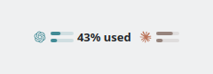
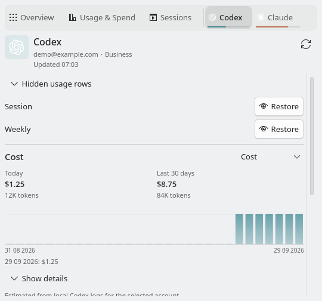
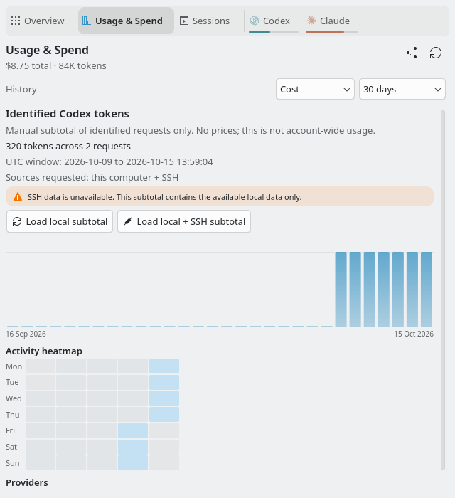
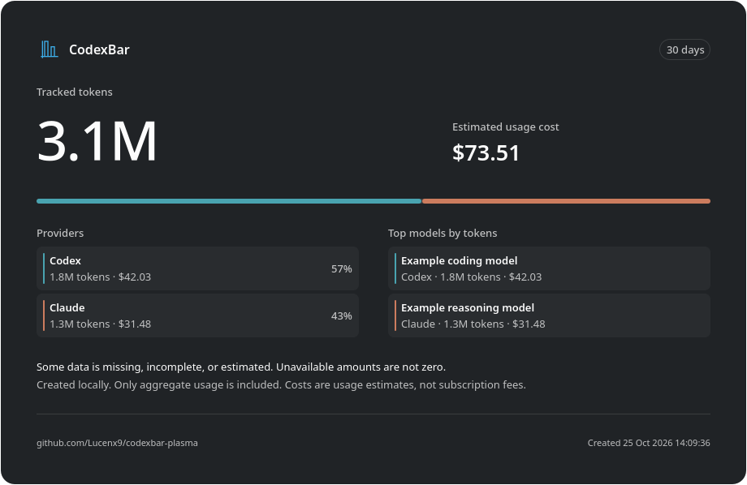

# Using CodexBar Plasma

See the [README](../README.md#install) for installation and first setup. This
guide covers display options, provider setup, history, notifications, and
defaults. Available data and actions depend on the selected official CLI.
The [documentation index](README.md) links the full CLI 0.56.2 audit and later
scoped evidence. [TODO.md](../TODO.md) tracks remaining Linux/Plasma parity
work and upstream contract requirements.

## Panel and popup

- Standard shows a small colored provider icon beside quota capsules. Minimal
  uses the same geometry with monochrome icons and capsules in the Plasma text
  color. Warning and critical colors remain independent for each quota.
  When a provider's brand hue is within 20 degrees of the theme's warning or
  critical color, its capsules use a muted version of the brand color, so a
  healthy quota cannot pass for an alert; the provider icon keeps the brand
  color. The muted color keeps the capsule's contrast with the panel and is
  used only when it looks less like the warning colors than the brand does,
  so a yellow brand beside a pale cream warning keeps its color. Any quota above zero keeps at least a round dot of fill, so an almost
  exhausted quota stays distinct from an empty one.
- Automatic panel meters show the primary quota above the secondary quota when
  both have percentages. A single available quota is centered vertically;
  absent quotas are omitted, while measured zero remains an empty track. If
  neither primary nor secondary has a percentage, the existing automatic
  preference supplies one available fallback quota.
- Provider meters work in horizontal and vertical panels. Names, usage text,
  and credit text remain horizontal-only. Click a provider's icon, capsules, or grouped text,
  or activate it with the keyboard, to open its detail tab. Hovering one
  provider's icon narrows the panel tooltip to that provider alone; hovering
  elsewhere shows the whole roster. Accessible descriptions identify the
  displayed quotas and their values. The standalone provider icon opens that
  provider's detail tab too, including when meters are hidden. With no panel
  provider selected, the widget icon toggles the popup without changing its tab.
- With the default element order, optional text sits after the selected
  provider's capsules in one group, with a single logo. The other providers keep
  their own icon and capsules. If that provider's meters are hidden or unavailable,
  its text keeps a separate identity. Custom element orders retain separate
  text and meter positions. Separate text keeps its identifying icon among
  multiple meters; a single selected provider meter does not repeat the icon.
- Panel width is bounded, so a crowded meter row can leave the optional text
  less room than every enabled item needs. Whole items are dropped rather than
  cut short, in a fixed order: the provider name first, because the icon beside
  it already identifies the provider, then the credit balance, keeping the usage
  text last. For a provider the widget has no icon for, the panel draws a
  generic icon shared with every other such provider, so there the name is the
  only identification and outlives the credit balance instead.
- Nothing that is dropped becomes unreachable. Accessible names keep the whole
  text, the panel tooltip reports each provider's quotas, incidents, and its
  credit balance while panel credits are enabled, and the popup keeps every
  detail. A single remaining item is elided only as a last resort.

  

- **Use monochrome icons and meters only** in **Additional information** selects
  Minimal and enables provider meters, including with a single
  provider, and hides panel names, usage text and credits. The style selector
  changes appearance alone. Existing installations keep their style, explicit
  quota choice, and visibility settings. Automatic meters gain the second quota
  without a new setting or additional CLI calls.
- Provider tabs with usage bars, reset windows, account identity, status, and
  credits. The tab surface marks the selected view; a provider tab's underline
  is its automatic quota meter, never a selection mark.
  The provider header and tab navigation stay visible while account choices,
  incident notices, errors, and usage details scroll below them. Switching
  provider or account starts the details at the top; refreshing the same account
  keeps the scroll position. Usage refreshes keep keyboard focus on the provider
  tab while the provider order remains unchanged.
  Account and plan share a line when they fit; narrow widths or larger fonts
  place the plan below the account. Each keeps its full-text hover tooltip when
  abbreviated, and the update time remains on a separate line.
- Provider tabs show **Plan renews on** and **Plan expires on** separately from
  quota resets when the CLI supplies valid subscription dates. Datetimes follow
  your regional date and clock format; dates marked as calendar-only keep their
  day without a time or time-zone conversion. Missing or invalid dates are
  omitted. Privacy mode hides them, and failed-refresh quota retention and the
  disk quota cache omit them. Dates alone remain useful even without quota rows.
  No subscription date is inferred from a quota window. The
  [pinned Linux evidence](research/2026-10-11-macos-parity-0.74.0.md#linux-cli-contract-changes-since-0730)
  verifies emitted dates in official 0.73.0/0.74.0 output; the date-only flags
  remain source-observed at 0.74.0.
- CLI usage marked `dataConfidence: "estimated"` keeps its numeric meters, but
  percentages say "estimated" in panel text, tooltips, Overview, and provider
  details. A `~` badge marks estimated panel meters when text is hidden. The
  provider detail explains that these values are not measured account quotas.
  Unknown confidence, including an explicitly empty CLI/cache value, has a `?`
  badge and an unverified-quota label.
  CLI `dataConfidence: "percentOnly"` shows plain percentages without a panel
  badge or repeated confidence notes. The provider's panel tooltip and
  accessible description explain once that the source supplies percentages
  and some details may be unavailable.
  Usage rows, Overview, and panel tooltips say "Reset unavailable" when no
  reset can be shown. This includes text-only resets hidden by privacy mode.
  This value was verified in official Linux CLI 0.74.1 output from
  `codexbar usage --provider claude --format json --json-only`, with
  `source: "claude"`, numeric primary/secondary percentages, a null primary
  reset and a secondary reset timestamp. It is preserved as a distinct state.
  Percentage-only rows show explicit CLI resets and pace forecasts in the popup
  and panel, including expected usage, run-out text and pace markers. They never
  infer missing reset dates or forecasts. Official Linux CLI 0.76.0 can emit
  both resets and pace with `percentOnly`, as verified by the
  [Claude detail contract probe](research/2026-10-15-claude-details-0.76.0.md).
  Privacy mode preserves structured expected usage and run-out forecasts while
  hiding account identity and prose-only forecast fallbacks.
  Estimated and unknown-confidence rows still suppress these details.
  These incomplete readings have no quota warning colors, threshold markers,
  or quota/pace/reset notifications. They do not
  rank automatic provider selection by consumption or satisfy conditional panel
  visibility rules other than Always. Provider status remains independent.
  A previously notified quota threshold survives these unverified readings, so
  returning measured usage at the same threshold does not repeat the warning.
  A measured recovery clears that threshold, and a later measured crossing can
  notify again. Unverified readings disarm pending limit-reset notifications.
  An announced pace warning also survives incomplete readings of the same
  window, so returning complete data does not repeat it. A measured recovery
  or a new reset window can establish a new warning.
  Confidence, including percentage-only readings, survives privacy mode, failed-refresh
  retention, and newly saved quota caches. Older CLI payloads and caches without the field keep their
  existing behavior; OpenCode Go estimates already saved by an older widget
  gain their qualifier on the next successful refresh.
- A plain credit balance has no allowance denominator and stays meter-free.
  A monthly Codex credit meter appears only when the CLI provides the validated
  `credits.codexCreditLimit` record. Its limit never applies to a plain balance.
  The monthly used, remaining, and limit amounts stay visible when popup pace
  text is disabled.
  A Codex extra usage record with nothing used and no cap is an empty
  placeholder and stays hidden; purchased credits remain in the Credits row.
- Codex reset credits use the CLI's usable-inventory summary when supplied.
  A reported zero hides the section even if the legacy aggregate is positive,
  so expired or redeemed credits are not shown as available. Older payloads
  without the summary retain the legacy count. A failed optional credit fetch
  does not hide healthy quotas.
- Panel text modes for percent used or left, pace, usage plus pace, reset time,
  and a run-out forecast that shows the predicted duration only while the CLI
  expects the quota to run out before its reset.
- Choose the automatic, primary, secondary, or tertiary quota for panel text and
  meters in **Panel → Quota, order and visibility**. An explicit primary, secondary, or tertiary
  choice shows one capsule. Automatic text and popup tabs retain their existing
  quota preference; automatic capsules use the pair described above.
- Set independent visibility conditions for the full panel text and each
  provider meter: always, minimum percent used, reset within a chosen number of
  minutes, or forecast exhaustion before reset. A provider meter stays visible
  when either displayed quota meets its
  condition; both capsules remain together. Text uses its own displayed quota.
  Conditions respect existing visibility checkboxes and need no extra CLI calls.
  Missing data does not satisfy a condition. Reset conditions update each minute;
  the provider icon remains available when all conditional elements are hidden.
- Auto-select highest-usage provider for the compact panel and provider detail
  focus. Measured consumption takes precedence even for fractional percentage
  differences; incident severity breaks equal-consumption ties, then saved provider order.
  An unavailable service status does not break a consumption tie.
- Panel providers can be limited to a chosen set in **Panel → Panel
  providers**. The choice lists the enabled providers in their saved order, is
  limited to the four meters the panel can draw, and can also be left automatic
  (every enabled provider). The panel meters, panel text, identity, and panel
  tooltip follow the choice; a popup selection outside the chosen set falls
  back to the first chosen provider, or the highest-usage chosen provider with
  auto-select. The popup keeps listing every enabled provider, and quota
  fetching and notifications stay unchanged.
  Clearing every checkbox hides provider text and meters while keeping the
  widget icon available to open the full popup. This explicit empty selection
  is saved as `__none__`; use **Use all enabled providers automatically** to
  restore automatic selection. Disabled providers retain their saved selection
  but do not occupy one of the four available slots. If more than four selected
  providers become enabled again, the first four in provider order appear.
- Overview tab with per-provider usage summary and quick switching. Each row
  draws a compact meter for the primary and secondary quota windows, such as
  **Session** and **Weekly**, each captioned with its title, reset and
  percentage, so a low session value never hides an exhausted weekly window.
  Cursor also keeps its **Included plan** meter once its total quota is
  exhausted. The panel's quota lane choice does not change these meters. Each row's
  detail line shows the account identity when the CLI provides one, and an
  active service incident otherwise; an operational status or the provider's
  own source name is never presented as identity.
  Provider icons and the navigation arrow share an identity header with the
  name and account. Quota captions and meters span the full content width below
  that header, giving resets more room in narrow popups. Each quota name is
  emphasized separately from its reset, which shortens first when space is limited; the
  percentage stays aligned with the end of its meter. Names and resets remain
  visible when the layout is mirrored for right-to-left languages.
- Screen readers hear what the popup draws. Overview rows describe their
  detail line, then each named quota with its reset; provider tabs describe
  the quota their underline draws, a last-known-usage note, and a refresh
  error that only dims the tab visually.
- Hovering or keyboard-focusing an Overview row whose title, detail line or
  quota caption is cut short in a narrow popup shows the full text in a
  tooltip. Hovering a global or provider tab whose name is cut short, an
  account button whose label is abbreviated in the middle, or a provider header
  title, account, or plan that is cut short, or a provider detail section title, row label or value
  that is cut short, shows the full displayed text in
  a tooltip. Quota-window titles, reset descriptions, and provider-chart titles
  and units also reveal their full displayed text on hover when truncated.
  Overview, Usage & Spend and Sessions header summaries, session names and
  session metadata also reveal their full displayed text on hover when truncated.
  The AI Insights Back button stays within the popup and reveals a truncated
  destination on hover or keyboard focus.
  Keyboard focus also reveals the name of a truncated or icon-only tab. Text that fits gets no tooltip.
- Refresh, copy, share, hide and tab-scroll icon buttons show their action
  labels on keyboard focus as well as hover. The copy confirmation takes
  precedence over its action label.
  Usage-row hide actions appear immediately on hover or keyboard focus.
  Provider action rows keep their full native hover and focus outlines visible
  inside the scrollable popup.
- Provider quota percentages use a slightly larger type size and align with
  the end of their meters. Pace forecasts and reset metadata share a line when
  they fit; longer text or larger fonts put the reset on a separate line below
  the forecast. Long forecast words wrap inside the popup, and an abbreviated
  reset still reveals its full text on hover.
- Overflowing popup tabs have separate scroll buttons and immediate keyboard
  focus reveal, so navigation never covers provider labels. A tab wider than the
  available area stays aligned at its start when focused or selected again.
- Popup tabs follow the usual tab keyboard pattern: Left and Right move focus
  between tabs and wrap around at either end, Home and End jump to the first
  and last tab, and Enter or Space opens the focused tab.
  Selecting a tab keeps its width stable, so neighbouring tabs stay in place.
  Overview, Usage & Spend, Sessions and provider headers use the theme's smaller
  text for summary and update metadata beneath their titles.
- Global **Usage & Spend** tab with a Cost/Tokens toggle, a range selector
  (7, 30, or 90 days, **Month to date**, or **All history**), interactive daily chart, activity heatmap, and provider totals that
  keep different currencies separate. Chart and heatmap dates use the system
  locale's short date format. Chart guide lines follow theme text-color changes
  while the popup stays open. Hovering or using the arrow keys to inspect a
  chart point shows a vertical guide, including for zero values and entirely
  zero-valued series. Abbreviated point labels or values reveal their full text
  in a tooltip while hovering the plot or keeping keyboard focus there.
  Keyboard inspection shows the readout immediately. These interactions also
  apply to provider cost and detail charts.
  Provider totals emphasize the selected Cost or Tokens metric, with the other
  figure on a smaller line beneath it. Missing amounts read as unavailable;
  measured zero stays zero. Long provider names and figures reveal their full
  text on hover. The heatmap groups the range into weekday
  rows, labelled with the system locale's short day names and starting on its
  first day of the week, so each weekday keeps its row as the range moves. Week
  columns hold cells that widen up to a 2:1 tile, leaving empty cells for unavailable days in the loaded
  calendar, including its first and last days, and for the rest of the newest
  week. Measured zero remains a recorded
  day. It stays hidden for ranges that fill a single column. A **Less–More** key
  beside the heading shows the cell shades from the lowest to the highest daily value.
  Provider totals and project groups follow the provider tab order.
  Cost or token sums that exceed the numeric range stay unavailable, with an
  empty heatmap cell for that day. Other dates and valid metrics remain visible.
- Usage, cost and account refreshes reject results from process failures even
  when stdout contains valid JSON, preserving existing data under their normal
  retention rules. The CLI's structured provider errors remain usable at
  its documented failure exits 1 through 4:
  healthy sibling results survive, failed accounts remain identifiable, and a
  confirmed missing-token-account result can clear that provider's account list.
  Cost argument errors retain the previous snapshot too, including when returning
  from an unsupported history range. Provider-list discovery requires a successful
  process exit.
- Local **Sessions** tab backed by `sessions --json-v2`; transcript paths and
  working directories are never rendered or opened. While the tab is visible,
  it rescans every 30 seconds, or at the refresh interval when that is shorter,
  so the CLI's active/idle state and its list of live sessions stay current even
  when periodic usage refresh is slower or disabled. Failed scans respect the
  same cadence from the failure or timeout, so reopening the popup or
  revisiting the tab does not repeat a failed scan immediately.
  A scan that exits with an error preserves the previous list and timestamp,
  even if it writes valid JSON. Only a successful empty scan clears the list.
  The Sessions refresh button can retry immediately; changing the CLI command
  clears the retry cooldown. Each card shows the project, a state marked with
  the theme's positive color while active, the provider (or `OMP` for an OMP
  Pi-family session), and the source. The host name appears only when sessions
  come from more than one host. Hovering a card reveals a copy action beside
  its title. Names and states share the first line; provider metadata and activity
  age share a separate line, so a long age does not shorten the name above it.
  Long states and ages stay within the card and reveal their full text on hover.
  Rescans with an unchanged session count update cards in place,
  preserving hover and keyboard focus at the same list position. A changed
  session count recreates the cards. Ages use the current clock after each scan.
- Overview providers can be limited to a chosen set of up to 3 providers, or
  left automatic (the first 3 eligible providers). The checkboxes recognize
  provider aliases and mixed-case IDs, like the panel provider selection.
  Disabled providers keep their saved selection without occupying one of the
  three slots. If more than three selected providers become available again,
  Overview shows the first three eligible providers in the saved provider order.
  Its header reports the shown count out of the full provider roster whenever
  Overview displays a subset, for example **3 of 20 providers**.
  A provider with valid detail sections or a dashboard summary stays eligible
  when the same response also reports an error. A failed provider with no usable
  data is omitted. An empty chart without titles, units, or valid points does
  not keep an otherwise empty failed provider visible.
  Provider selection checkboxes preserve literal characters such as `&`, `<`,
  and `>` in display names, including with KDE desktop styles.
- Usage dashboard summaries for provider payloads that expose API spend,
  request, token, model, or dashboard fields through the CLI. Summary metrics
  use equal columns aligned with the Cost summaries. Truncated summary labels
  and values show their full text on hover. Long detail values stay within
  half the row and also show their full text on hover.
- Declarative provider detail sections from the CLI `usage.details` contract,
  including labeled rows, secondary values, and keyboard/pointer-inspectable
  bar/line charts. A row that carries a valid `progress` used/total pair, such
  as a Bifrost budget, also draws a thin meter under its text; the meter fills
  at most to the total, and rows without a valid pair keep their text alone.
- Usage rows take the widget's translated title for known providers. A
  provider without one uses the CLI's own English title from `rateWindowLabels`
  (such as `Memory`) instead of the generic `Session`, `Weekly`, or `Opus`;
  privacy mode and quotas restored after a restart keep the generic title. A
  restored extra window is labeled by its CLI window ID when it has one.
- A usage row in a provider tab can be hidden with the button that appears
  beside its percentage on hover or keyboard focus. Primary, secondary, and
  tertiary rows and extra windows with a CLI window ID can be hidden; credit
  rows use the **Show credits and reset credits** option instead. Hidden rows
  leave only the provider tab: fetching, notifications, the panel, and the
  Overview summary still use them. Expand **Hidden usage rows** below the
  provider's usage bars and select **Restore** beside a row to show it again
  immediately, including when every bar is hidden. The list includes only
  rows currently returned for that provider. **Settings → Popup → Hidden usage
  rows** can also restore saved rows by provider and row name, or extra window
  ID; **Apply** saves a settings-page restore. Restored quotas keep extra window
  IDs, so a hidden extra window stays hidden after a restart.
  Up to 64 rows can be saved as hidden. At that limit the hide button disappears;
  restore a saved row to make room for another. Long provider IDs that require
  JSON escaping retain their saved choices too.

  

- Titled provider detail sections can also be hidden with the button beside
  their title on hover or keyboard focus. Expand **Hidden detail sections** in
  that provider's popup to restore one using its current CLI title. The list
  starts collapsed for each provider and collapses again once nothing is hidden. **Popup →
  Hidden detail sections → Restore all** restores all sections for a provider
  when you apply settings, including sections no longer returned by the CLI.
  Only provider IDs and title digests are saved, never the titles themselves.
  Up to 64 section choices are retained, including for long provider IDs that
  require JSON escaping.
  Equal titles within a provider hide and restore together; reordered sections
  stay hidden, renamed sections appear again, and untitled sections stay visible.
  This display choice does not change fetching, notifications, the panel, or
  Overview. Privacy mode hides the restoration list along with provider details.
  Rows and sections hidden or restored in the popup while settings are open
  stay as chosen when you apply settings; the settings pages keep only their
  own pending restores.

## Data freshness

Popup refreshes and settings checks run independently for each widget instance.
Starting the same check in another widget or reopening a settings page does not
reuse an earlier request's result.

With GNU `timeout` available, usage, cost, session, account, provider-list, and
provider settings commands also have a process deadline. A hung CLI and its
children receive a termination signal two seconds after the request's UI
deadline, then are killed if still running one second later. Cancelling a
request or closing the widget or settings retires its result immediately and
leaves this process deadline in place.
Without GNU `timeout`, the UI deadline still applies, but cannot stop a hung
process.

When no provider data is available, the popup offers **Configure providers**
with a hint to open **Providers** in widget settings. A confirmed empty list of
enabled providers uses this setup state and still clears previous quotas and
their cache. Global and provider usage errors offer **Retry** and **Settings**,
with a hint to open **Diagnostics** for
connection checks.

A network failure reads as a warning instead of an error. When the CLI message
carries a Foundation URL error code or an unresolved host, the popup puts
**No internet connection** or **The provider did not respond in time** above
the original message; other provider errors keep the CLI text unchanged. With
Qt's `QtNetwork` QML module (Qt 6.7 or later), the widget also follows Plasma's
network reachability. Without an internet route, a timeout reads as no
connection and the hint says usage refreshes when the connection returns:
about two seconds after the route returns, the widget refreshes usage without
waiting for the refresh interval. Local sources keep refreshing while offline.
Without the module, or while reachability is unknown, refreshes follow the
configured interval.

Long error messages scroll with the view's content, including when no data is
available. The tab navigation and each view's header remain reachable with
larger fonts. Usage & Spend also keeps its history selectors above the scroll
area.

A command Plasma cannot run at all takes a separate state. When the shell
reports that the configured command was not found or is not executable, the
empty popup says **CodexBar CLI not found** and names the configured value.
**Install and use CLI** prepares and selects a private official copy immediately;
it can be tried again if preparation fails. **Settings** opens Plasma's standard
widget settings window, where **Diagnostics** accepts an external CLI path.
Opening settings does not change configuration or run diagnostics automatically.
The setup state stays visible across Usage & Spend and Sessions. Retained
providers and a refresh in flight take precedence over it. Any other failure
keeps the existing error and provider setup states.

**Retry** starts the existing manual quota refresh, including a fresh provider
list, and is disabled while a usage refresh is running. It does not scan local
cost history or sessions. The existing last-known quota and timestamp rules
below also apply while retrying and after another failure.

Malformed optional login-method metadata does not discard valid provider quotas
or named accounts. The Codex plan label uses the same validated login method as
the account details, including a valid fallback supplied by the CLI.

Failed usage refreshes keep the last valid quotas visible. Each retained provider
shows **Last known usage** with the age of its measurement in the popup and panel
tooltip; its panel icon and capsules are dimmed. Errors remain visible. A provider
error with an empty or malformed message shows a generic error and follows the
same quota-retention rules. A partial
refresh updates healthy providers independently, and a successful refresh removes
the retained-data indication. When a provider-scoped reply contains multiple
records, an unreadable record does not prevent a later healthy record from
updating that provider; a reply with no readable records remains an error.
Retained data never generates quota, pace, reset,
or status notifications, and its pace and run-out forecasts are suppressed,
including in privacy mode. If a failed
quota response includes newly fetched service status, that status still updates
and can trigger incident notifications independently of the retained quotas.
Stale quotas preserve the previous quota, pace, and reset notification state,
even when the CLI reports success with old quotas and current status. If no fresh
quota has been seen, the first fresh authoritative measurement establishes that
state silently. Estimated, percentage-only and unknown readings do not establish
that baseline.
Panel and popup run-out countdowns advance from the receipt time of their own
forecast.
Selecting a cached account preserves that time, including in privacy mode;
a later refresh for another account cannot restart its countdown.
Failed refreshes stop reusing measurements older than 24 hours, and a quota
measurement older than 24 hours never stamps a new snapshot as fresh. A failed refresh that
reports a different account than the retained measurement does not reuse it; a
failure that reports no account still does. The existing minute
timer also removes expired retained data when automatic refresh is disabled;
the error remains visible and healthy providers are unaffected. Successful
responses without measured quotas keep their valid credits, subscription dates,
or details even when their supplemental timestamp is old; they do not enter quota retention or expiry.

The widget automatically saves a small quota cache in its Plasma configuration.
After a restart it verifies the CLI configuration fingerprint before restoring
the cache, then refreshes in the background. Malformed checksum replies leave
the current fingerprint and quotas intact. Restored quotas are always marked
last known, even if they were saved recently. A cache is not a successful refresh.
If a partial refresh finishes before that verification, its results take
precedence for the providers it returned. Other cached providers are restored
as last known and included when the merged snapshot is saved.

Explicit account selections last only for the current session, so the disk
cache leaves out every provider with a selected account. Its quotas are never
restored as the default account's after a restart, and a restore that finishes
after a selection never fills that provider with default-account quotas. Other
providers keep being saved and restored while a selection is active, and a
provider is saved again once it returns to its default account.

The disk cache is limited to 64 KiB of UTF-8 on both save and restore. When
providers exceed the save budget, it keeps the leading providers that fit rather
than discarding the entire cache. The live provider list is unaffected. It holds
at most 64 providers and only their primary, secondary,
tertiary, and up to 24 extra quota windows per provider, with only percentages,
bounded semantic usage confidence, reset timestamps, measurement timestamps,
identifier-shaped extra window IDs, and an opaque configuration fingerprint. It contains no account identities, credentials,
provider prose, cost history, session data, or paths. Entries older than 24 hours,
future-dated entries, corrupt records, and unsupported cache versions are ignored.
Supplemental sections (cost, credits, detail views, token costs) are hidden
while usage is stale, including after cost refreshes and history-range changes,
and are not restored from disk; only the retained quotas carry the last-known
indication. A missing, invalid, or future live measurement timestamp uses its
original receipt time. Selecting a cached account preserves that fallback and
its 24-hour retention deadline, even if the CLI timestamp has since become past;
future timestamps in persisted records are rejected. The 24-hour limit is a widget policy, not a guarantee
that a retained quota remains accurate throughout that period.

Changing the CLI path, provider/source override, provider configuration, or selected
account invalidates the affected retained data. A per-provider reset keeps
healthy providers' disk cache; a full reset clears it. Disabling all
providers clears the cached quotas. A confirmed successful response without a
quota removes its previous value; measured zero remains zero. Privacy mode hides
identities as usual and keeps the last-known indication visible.

## Providers and accounts

If Plasma cannot run the CLI, the popup keeps its installation guidance visible
when switching to Usage & Spend or Sessions. Open **General → Managed CLI** in
widget settings to install and select a private CLI, then **Apply**. For an
existing installation, use **Diagnostics** to set the absolute executable path.

A failed provider-list refresh in settings keeps the last loaded list and shows
an error. A successful empty list clears it.
Reloading the same CLI keeps known setup controls visible while its version is
checked again. API key setup waits until that check and the list reload finish.
Provider settings diagnostics also keep their last successful result and show
an error when the CLI process fails or returns an invalid response. A failed
process cannot replace the result even when it prints valid diagnostic JSON.
An error inside a successful diagnostic report describes a failed provider fetch.
**Fetch error** shows the CLI's redacted description of that failure, and
**Fetch attempts** lists each attempt's kind and outcome, such as
`oauth succeeded`; authentication and settings details remain available too.
Saving a provider configuration change clears that provider's previous diagnostic
result and error. Older diagnostic replies cannot restore them. Select **Inspect
redacted settings** again to inspect the new configuration. Failed changes and
cancelled prompts preserve the last diagnostic result.
JSON parsing errors in provider settings are bounded and redact credentials
before they appear in the error message.

Provider-specific editable settings depend on the official CLI contract.

- Search providers by name or ID and filter All, Enabled, or Disabled locally.
  Clear filters restores the list without changing selection or provider settings.
  Hover a row whose name or ID is cut short to read both in full.
  Keyboard focus stays on the provider row or switch when the list refreshes.
  A pending switch keeps focus and ignores repeated activation until its command
  finishes. Moving to another control during the command keeps focus there.
- Provider enable/disable and setup actions write CodexBar configuration
  immediately; Apply and Cancel cover widget settings only.
  A CLI error with an empty or malformed message shows a generic failure
  instead of confirming that the change was saved.
  CLI 0.65.0 drops user provider plugin entries and their stored secrets when
  `config disable` runs. Update to CLI 0.66.0 before disabling a provider if
  you use user plugins.
- Opening an API key prompt preserves the provider's current enabled state
  until a successful save reports its new state.
- API key and secret prompts stay open while you type. A prompt left open for
  about 15 minutes closes by itself, the provider's actions unlock again, and
  the prompt can be reopened. Submitting near that limit still allows the full
  one-minute save timeout, followed by up to five seconds to stop the command.
- Account discovery and selection through `codexbar usage --all-accounts`.
  Codex selections refresh that list and display the matching account; Codex
  does not accept the token-account `--account` option. This selects the
  widget's displayed usage, without changing the Codex CLI login. If the
  selected account disappears, use **Use default account** next to the account
  reload button to return to the CLI's default usage. Other providers retain
  their supported token-account selection. When discovery finds no named
  accounts and none is selected, the account area says that the provider's
  default account is used. For a provider without token-account support it says
  that CodexBar cannot switch its accounts and disables its **Accounts…** entry;
  the reload button can retry. Either explanation disappears when the popup
  closes; an unsupported provider's **Accounts…** entry stays disabled. Changing
  the CLI path, provider, source or CodexBar configuration, or installing a
  managed CLI, enables the entry again.
  Local cost history is independent of this selection; changing accounts does not filter the local cost scan.
  Repeated records for the same account keep the first successful read, so an
  earlier failed record cannot hide valid quotas. Accounts retain their original
  list order and distinct selection keys, including differences in spacing.
  Up to three account choices stay inline. Longer lists start behind the
  **Accounts** disclosure so quotas remain visible; selecting an account closes
  the list, and switching providers resets it. Refreshing the same list keeps
  it open. Reload, default-account selection, and discovery errors remain
  available while the list is collapsed. Keyboard focus on the reload and
  default-account buttons reveals their labels in tooltips.
- Provider docs, dashboards, login/account links, and redacted diagnostics.
  The selected provider's links, settings and diagnostics share one surface
  above the provider list; **Settings and diagnostics** starts collapsed.
- With the official CLI 0.56.2 verified by this repository, the Providers page
  offers enable/disable, supported single API key setup, CLI command hints, and
  docs/dashboard/login links.
- The widget also has a renderer for the proposed
  [provider settings descriptor](cli-provider-settings-descriptor.md).
  Scoped checks through CLI 0.82.0 still find no descriptors, so cookie, base
  URL, workspace/project, region, and other descriptor-backed editors remain
  unavailable. CLI 0.82.0 adds `codexbar config set-cookie --provider <id>
  --stdin` and `codexbar config clear-credential --provider <id>` for manual
  cookies and stored keys; the widget does not offer them yet, so run them in
  a terminal. CLI 0.73.0 separately supports persistent source writes through
  `codexbar config set-source --provider <id> --source <mode>`; `auto` clears
  the saved override. With CLI 0.73.0 or later, open **Providers → Settings and
  diagnostics**, choose a **Source mode**, and select **Save**. The choices
  are Automatic, API, CLI, OAuth, and Web; CodexBar validates which modes
  the provider supports. Unsupported choices show an error without confirming
  a save. The selector starts at **Choose a source** because the provider
  registry does not expose the saved mode; inspect redacted settings to
  request source details.
  Changes are saved immediately, independently of Apply and Cancel. A successful
  save preserves provider enablement and credentials and invalidates cached
  usage through the existing provider-config revision. The source override in Diagnostics
  still takes precedence globally for widget requests. Older or unrecognized
  CLI versions omit the editor.
- Gemini under the default Automatic source: CLI 0.77.0 through 0.80.0 on Linux
  rejects Auto for Gemini as a macOS-only web source, so signed-in Gemini users see an error
  where 0.76.0 worked. CLI 0.81.0 fixes this. With an affected CLI, update it, or open
  **Providers → Settings and diagnostics** for Gemini, choose **API** as the
  **Source mode**, and select **Save**. Plasma never rewrites the saved source for
  you; switch back to Automatic after updating to 0.81.0 or later.
- Single API-key setup for Tavily, Linkup, Aerostack, Sail Research, and Sofya
  uses the official Linux CLI writer verified at 0.74.0. Exa and Cosmic AI have
  metadata and dashboard links, but their additional key/project IDs have no
  supported writer. TinyApi and X API are web-only on macOS. Those four expose
  no unsupported key action; the missing Linux setup remains tracked in TODO.
- Generic API key setup for Fireworks, when the selected CLI reports version
  0.54.0 or later and can discover the account slug from the key.
- Single API-key setup for Command Code and fal appears when the selected CLI
  reports version 0.75.0 or later. The secure prompt sends the key through CLI
  stdin. Command Code's Automatic source selects API when a key is configured;
  fal needs a key with billing read access. FLORA and Parallel have metadata
  and links, but no key setup action. FLORA also needs a workspace ID with no
  supported Linux writer, and Parallel needs a manual cookie (CLI 0.82.0
  `config set-cookie`).
- Munito offers single API-key setup with CLI 0.77.0 or later, using the
  secure stdin prompt. Use an admin key with Read account data permission.
  Future AGI has fallback metadata and links, but no key setup action: it
  requires both `FI_API_KEY` and `FI_SECRET_KEY`, and the second credential has
  no supported Linux writer.
- Claude Platform has its own fallback name, the shared Claude icon and brand
  color, and Console billing, login, status and documentation links. Its
  `claude-platform` alias resolves to `claudeplatform`, separately from Claude.
  The widget has no cookie setup action for it; with CLI 0.82.0 or later, store
  a manual Console cookie with `config set-cookie` in a terminal. Opening the
  login page does not configure CLI authentication.
- Fallback names, icons, and documentation links for all 106 providers in the
  official CodexBar 0.77.0 registry, plus colors, links, and aliases where
  upstream defines them; fork-only provider assets, and those for providers a
  later CLI retired, remain available for compatibility.
  Providers without bundled artwork use the theme's generic statistics icon
  in the panel, popup, and settings.

## Costs and history

With local history enabled, the widget scans it at startup and about once per
hour, including while the popup is closed, so provider cost summaries are ready.
Opening Usage & Spend also refreshes stale history. Sessions are loaded only
while their tab is open.

### Identified Codex token subtotal

Enable **General → Usage history → Show identified Codex token subtotal** to
add a separate section to the global **Usage & Spend** tab. It is off by
default and requires official `codexbar` 0.75.0 or later on each selected
computer, plus GNU `timeout` on this computer. Choose its independent 1–365 day
window in General. This window
starts at midnight UTC and ends at the exact load time displayed in the result;
it does not follow the cost chart's calendar periods or range selector.
The loaded token/request subtotal is emphasized; the unloaded placeholder uses
secondary text.

**Load local subtotal** scans only this computer, even when an SSH host is
saved. To include another computer, enter one SSH alias or `user@host` in
**Optional SSH host**, apply the settings, and choose **Load local + SSH
subtotal**. The host accepts ASCII letters, digits and `._-@:%[]`, at most
255 characters, with no leading `-`, spaces, or command options. The SSH button
is available only for a valid host. Configure authentication and trusted host
keys outside the widget first. The CLI uses batch SSH with strict host-key
checking; the widget does not prompt for passwords or accept unknown host keys.

Enabling the section, opening the popup, changing its settings, or refreshing
ordinary cost history does not start an identified scan or SSH. Each load
requires its own button. The section remains available when ordinary local
usage and spend history is disabled. Selecting a single provider in General
hides the global tabs, including Usage & Spend.

The subtotal covers identified requests found in the selected native Codex
histories, **not account-wide usage**. The CLI deduplicates shared identities
across sources. Input includes cached input and output includes reasoning;
these breakdowns are not added again. Prices are unavailable. The number is
kept separate from cost totals, charts, sharing, AI Insights, and quota data.

Unavailable local or SSH data leaves the other source's validated subtotal
visible with a warning. Conflicting or excluded requests have a separate
partial-data notice and counts, even when every source responded. An empty
available history measures zero; unavailable data does not. The displayed UTC
window identifies the snapshot, which changes only after another manual load.

Results stay in memory until another load, a relevant setting change, or widget
destruction. Request identities, raw ledgers, SSH errors and host labels are
never included in the displayed or persisted result. The configured SSH host
remains editable in General, including in privacy mode. Loads time out after
120 seconds in the frontend. An independent GNU process-group timeout sends
TERM after 110 seconds and KILL after another 5 seconds, before the frontend
deadline. It keeps bounding the CLI and its group after a settings change or
widget destruction retires the reply; retirement alone is not process
termination. Without `timeout`, collection refuses to run. Responses above the
frontend's 4 MiB JSON limit or outside its
supported schema/count bounds are rejected, without truncating a subtotal.
Real SSH authentication and connectivity remain untested; regression checks
use synthetic subprocess transport.

### Share usage

Choose **Share AI usage** in the Usage & Spend header to open a separate window.
It uses the selected history range and freezes the currently loaded data until
reopened. It does not start another CLI scan. Refresh history first for a newer
snapshot; the creation timestamp is not a measurement timestamp.

**Copy image** places image data on the clipboard, **Copy statistics** copies the
same aggregate figures as plain text, and **Save PNG…** opens the platform save
picker with overwrite confirmation. Saving supports local PNG files. The image
uses the Plasma colors and fonts and includes a small
`github.com/Lucenx9/codexbar-plasma` attribution in its footer.

Totals include the loaded providers; at most eight provider rows and six models
are shown, ranked by tokens, with omitted row counts. A colored bar under the
totals and a percentage in each provider row show its share of tracked tokens;
omitted providers leave the end of the bar uncolored. A nonzero share below 1%
reads `<1%`, and the bar is replaced by a plain divider when no provider
reports tokens. Model rows without a token
count are excluded from the ranking. Currencies remain separate. Unknown values
are not zero, and incomplete or estimated data retains a notice in both exports.
The ordinary six-row display limit alone does not trigger that notice.
Missing costs on a model's measured token days and source scans that reach their
safety bound still trigger it, including in privacy mode.
Costs estimate usage, not subscription fees; subscription plans are not exported.

Only aggregate fields enter the export. Account identities, projects, absolute
paths embedded in model labels, raw diagnostics, and conversation content are
excluded. A model label containing an absolute path is redacted in full,
including paths with spaces. Privacy mode keeps its model anonymization and
masks unknown provider identifiers in both exports; changing that setting closes
an open snapshot.
Nothing is uploaded. Copying or saving is an explicit action. The exported file
and clipboard content remain under your control after closing the window.

### History details

- Local cost drill-down when the CLI exposes cost data.
- In the verified CLI 0.56.2 contract, Antigravity supplies token-only local
  history; its dollar amounts remain unavailable. Official CLI 0.62.0 adds the
  same token-only history for Muse Code, read from local Muse session logs
  with unavailable monetary fields absent. Cursor local or dashboard
  cost is rejected by the Linux CLI. Other provider fields, including Kiro
  overage, z.ai BigModel CN balance, and Cursor Grok Bot usage, use the existing
  generic detail, provider-cost, and extra-window paths.
- A compact provider summary compares today with the selected period. Expand
  details for period models, history, and projects; cost warnings remain visible,
  including when a failed refresh keeps the previous cost snapshot. A successful
  refresh clears the error. Today comes from the day of the last cost scan, so a
  snapshot scanned before midnight shows today as unavailable until a scan from
  today arrives. Malformed provider error messages use a generic
  warning while healthy providers update and failed providers keep their
  previous costs. Malformed period metadata also keeps the day-range fallback
  and any legacy range label usable while healthy providers update.
- Dated history stays inside the selected period even when duplicate or
  malformed records prevent filling gaps. Incomplete scans retain observed
  days without inventing zero activity; undated legacy history keeps its order.
  Object and array date fields cannot expand **All history** or prevent healthy
  providers from updating.
- Click a day in the provider chart or select it with the keyboard to see that
  day's model costs and tokens. Hover previews stay inside the chart, keeping
  the layout steady. The section's Cost/Tokens toggle shows both choices,
  switches with one click like the one in **Usage & Spend**, and reuses the
  loaded data.
  Missing model breakdowns and truncated lists are identified explicitly.
  The selected day and expanded provider details survive a refresh that adds
  a day to **Month to date** or **All history**.
- Local-history scans run independently from quota refreshes, automatically
  about once an hour; the **Usage & Spend** refresh button starts one immediately.
  Revisiting **Usage & Spend** refreshes history that became stale since the last
  scan, and a spend view left open across midnight refreshes once for the new day.
  Switching the Cost/Tokens metric or inspecting a day reuses the loaded data and
  starts no scan. Cost settings applied together start a single scan using the
  final executable, provider, and history range; disabling costs starts none.
  A selected day in the **Usage & Spend** chart stays on that date through a
  refresh. Removing the day or changing the history range or metric clears the
  selection.
- **Month to date** and **All history** ask CLI 0.67.0 or later for that
  calendar period (`cost --period`); an older CLI shows a message naming the
  required release, and the day ranges keep working. Choosing a day range in
  **Usage & Spend**, or a history window in the settings, returns to days.
  An unapplied history-window edit in General keeps its day count and day mode
  together if the popup changes ranges; Apply saves that pending choice.
  **All history** totals cover every recorded day. Its chart, heatmap, and
  history rows start at the oldest recorded day and show at most the newest
  365 days; its model totals and daily average cover up to the newest 2,048
  daily records, even when those records span more than 2,048 calendar days.
  Empty dates are counted without allocating a row for every day in that span.
  Dates after a snapshot's scan day do not extend that history
  or lower its daily cost and token averages.
- Token breakdowns, model summaries, recent daily spend, cost history bars, and
  average cost per 1M tokens, with a configurable cost history window. Recent
  history rows show measured zero costs and token counts alongside positive
  amounts; missing amounts stay omitted. Their bars stay proportional even for
  very large reported amounts. Daily averages avoid overflow when summing those
  amounts. Average cost per 1M tokens also avoids intermediate overflow; a rate
  outside the numeric range is omitted. The daily average stays visible for a
  range measured as zero, and the peak still names a day only once something
  was spent.
- Monetary amounts use two decimal places; amounts that round to zero omit
  the negative sign. This formatting does not change the underlying totals.
- **Quota weeks** in the expanded provider details split the local history by
  the provider's weekly quota window: the current week so far and up to three
  earlier ones. Each row shows its start and end; the current row ends at the
  upcoming reset. Right after a reset, the current week holds no full day yet
  and is left out until it does. The boundaries come from the weekly usage
  row's reset time and window length, so the list appears once a live usage
  refresh reports them. History is kept per day, so when the reset
  falls inside a day that whole day counts toward one week, and the totals are
  marked `≈`. Unknown or missing days, and days with requests excluded from
  the CLI totals, make a total read "at least". Cost totals keep their currency
  in privacy mode. Weeks reaching back before
  the scanned history range are left out rather than shown incomplete. If the
  last successful cost scan is older than today, its last day was scanned only
  in part, so that day and any unscanned trailing days also make the affected
  week read "at least". When the CLI reports that history
  coverage is still being established, every displayed week reads "at least"
  even if its recorded days have numeric amounts. If a local midnight clock
  change prevents Qt from advancing the calendar, the affected week and older
  weeks are omitted; newer valid weeks remain available.
- Token, request, and point counts use the current language's singular and
  plural forms. Large counts retain compact notation such as `1K` and `4.3B`,
  with the regional decimal mark that costs use, such as `4,3B` in Italian.
- Cost totals qualified as estimated, partial, or approximate from the CLI's
  bounded pricing coverage and provenance metadata.
- Project cost and token totals in **Usage & Spend**, ranked within each provider
  by the selected metric and using the same history range. The official CLI
  0.56.2 exposes project data for Codex. Missing amounts remain unavailable;
  project paths and nested source records are discarded. The bounded list
  signals omitted projects and does not change provider or global totals.
- Cost-trust notices appear as quiet footnotes with a small icon, like the
  other informational notes in Spend; errors with recovery actions keep the
  standard message. They explain why a range is incomplete or estimated, including
  how many requests the CLI excluded from the displayed totals because they
  lacked final usage. Closing a
  notice suppresses the same meaning for that provider or the aggregate Spend
  view across refreshes and popup reopenings; a materially different warning is
  shown again. A changed count of excluded requests describes the same warning
  and stays closed.
- Recent-day history rows, model rows, and a selected day in a provider's cost
  details state how many incomplete requests the CLI excluded from that row's
  amounts. The amounts themselves stay as measured.
- A provider's cost chart, history rows, peak line, latest-day summary, and
  selected-day title use the system locale's short date format.

See [Cost history](cost-history.md) for data bounds, selection rules, and
evidence. Dashboard extras and additional history views require official CLI
fields; track proposed extensions in the issue tracker.

## Status and notifications

- Provider status incident badge in the panel and provider detail view. The
  detail view states a current incident once, in a compact pill below the
  header tinted with the severity color, which always names the severity even
  without a CLI description; the header badge is only a fallback for an
  incident with no pill text. The
  panel badge sits on the incident provider's own meter icon, follows provider
  reordering, and stays visible while a refresh runs. The standalone
  service-status panel element remains a fallback when no meter can carry the
  badge, such as hidden meters or an incident provider without meters. When
  meters are hidden in a vertical panel, the identity icon carries a badge only
  for its own provider's incident; an incident on another provider keeps the
  standalone fallback. Incident selection, badges, pills, and tooltips ignore
  a provider whose current status is unknown or has no active incident. When a
  refresh omits status, a previously retained outage is hidden; this is not
  evidence of recovery. Current status can still report an incident when quota
  fetching fails.
- Status Page in the provider actions expands, for Claude, Claude Platform,
  Codex, and OpenAI, into the service components of the public status page:
  status.claude.com for Claude and status.openai.com for Codex and OpenAI, whose
  groups such as APIs, ChatGPT, and Codex expand into their components. Each
  Status Page header is one clickable row, with its disclosure arrow inside
  the hover and keyboard-focus highlight. Click the title or arrow, or use
  Space while focused, to expand or collapse the list. Each component shows
  a colored dot and its state. OpenAI group states include all visible components
  in the feed, even when the list exceeds the 64-child display limit. A list
  too long for the widget's 256 KiB reader limit omits its trailing components.
  Malformed individual entries do not discard healthy components. An unreadable
  component status or an OpenAI component without a usable ID is shown as unknown.
  The list is read when expanded,
  through `scripts/status-components.py`, because the official CLI reports only
  the overall status. Open Status Page at the end of the list opens the site;
  other providers keep opening it directly. A page that cannot be read shows
  the status as unavailable and leaves the provider's CLI status unchanged.
  Switching tabs, opening AI Insights, or closing the popup closes the list
  and retires its pending request. Expanding it again fetches fresh status.
- Optional quota warning markers on usage bars. Pace and warning markers keep
  a thin background edge, so they stay visible where they cross the colored
  fill. Forecast parts are separated with ` · `, like other popup metadata.
- Optional Plasma notifications for provider status incidents, configurable
  quota crossings, predicted quota exhaustion from CLI pace data, and when a
  heavily used limit resets back to empty. A temporarily omitted usage window
  preserves its notification baseline: returning at the same threshold does
  not repeat a warning, and a previously armed reset can still be reported.
  Named extra windows keep separate baselines by their CLI IDs, even when
  their labels match or their display order changes.
  A status page that cannot be reached does not trigger an incident notification
  or establish a status baseline. It preserves the previous notification state,
  so it does not announce an ongoing incident again once the page answers.
  Notification text is shown
  literally: markup in provider or status text never becomes a link, emphasis,
  or an image.
- Clicking the available-update notification opens that release's page on
  GitHub, addressed from the tag the updater announced. The notification stays
  non-clickable when the release address is unknown or the installed
  `notify-send` predates notification actions.

## Settings

- Seven settings pages: **General**, **Providers**, **Panel**, **Popup**,
  **Notifications**, **AI Insights (Beta)**, and **Diagnostics**. CLI path and provider/source overrides
  sit beside redacted diagnostics; quota thresholds sit beside their alerts.
  **Popup** lists hidden usage rows under **Popup** and groups provider order
  and Overview providers under **Providers**;
  **Diagnostics** runs redacted diagnostics from its **Provider diagnostics**
  section. The provider lists in **Popup** and **Panel** settings require a
  successful CLI process. Failed loads show the CLI error or exit code even
  when the process writes valid provider JSON.
  Changing the CLI path immediately clears the previous CLI's list and retires
  its pending replies, including while **Panel providers** is collapsed.
  Explanatory text is set in small secondary type below the control
  it describes, and dependent options are indented under the option they need.
  Number fields keep units in their labels so multi-digit keyboard edits work
  with the KDE desktop style. They accept the regional locale's digits and
  grouping separators, including Arabic, Persian, and Bengali numerals.
  **Notifications** previews the quota warning and critical color ranges as
  you edit their thresholds. The legend names both thresholds beside a swatch
  of their color; the scale uses your Plasma theme and mirrors in right-to-left
  layouts. **Apply** saves the
  pending values. The preview remains available when notifications are off,
  since the same thresholds also control usage-meter colors.
  **Diagnostics** also reports the widget version, and, after **Check
  versions**, the CLI version and the absolute command the shell resolved.
  **Support report → Collect support report** gathers an offline Markdown
  report, ready to paste into an issue with **Copy report**. Expand **Report
  preview** to review it first. It includes the installed widget and
  Plasma/KDE Frameworks/Qt versions, selected and PATH CLI version/manager,
  enabled provider IDs, the current Diagnostics form overrides, the latest
  error observed in this Diagnostics session, and QML module/supporting-tool
  availability.
  The report uses English technical labels for support across languages.
  It does not run provider diagnostics, fetch usage, check upstream releases,
  or include diagnostic output, account labels, credentials or config dumps.
  Resolved filesystem paths are omitted, while the report states whether the
  selected and PATH CLI resolve to the same location. Entire error lines that
  contain filesystem separators are also omitted, including absolute, relative,
  tilde-qualified and space-containing paths. Common permission, missing-file,
  executable-format and shared-library startup reasons remain as fixed text.
  Lines already containing credential-redaction markers are omitted too, since
  that filtering may have hidden a path separator. Recognized identifiers are
  redacted. Credential filtering covers secret-key and secret-access-key
  assignments, including `AWS_SECRET_ACCESS_KEY` and `secretAccessKey`, in CLI
  messages, Diagnostics, and shared reports. It also recognizes credential names
  inside escaped JSON strings; an escaped quoted value removes the rest of its
  line to avoid retaining fragments of the secret.
  The local **Check versions** display still shows the full path.
  Versions come from offline `kinfo`, installed Debian package metadata when
  available, `kf6-config`, and Qt 6 `qtpaths`; unavailable versions remain unknown.
  Module checks use this QML engine; PlasmaCore remains explicitly **not
  checked** to avoid initializing another shell theme solely for the probe.
  Tool presence is not a functional test.
  Collection requires `python3` and GNU `timeout`. Partial results can still be
  copied if the helper fails or times out. No popup error history is read from
  another process; the error section explicitly names its Diagnostics source.
  A subsequent Diagnostics failure refreshes the report's error section without
  rerunning the offline checks; form overrides use the widget's whitespace trimming.
  Collect again after changing provider settings. Editing the command path or
  widget overrides discards the previous report. The separate **Check versions**
  probe runs only when asked; a changed command path clears its previous result.
  The widget version is available as soon as Diagnostics opens. The command
  path has a screen-reader label and supports the form label's keyboard shortcut.
  Its field yields space to **Use PATH** in narrow dialogs with larger text,
  keeping the button and the form's explanations inside the page.
  Provider option controls and their Set/Save actions expose the field title
  to screen readers; Diagnostics override fields and output also have names.
  **Popup** and **Notifications** keep their text and controls still while the
  page opens, including while the Popup provider list arrives.
- **Popup** helper notes use smaller secondary text beneath the controls.
  Hidden-section, hidden-row and provider-order lists share aligned, themed
  provider icons; stacked restore actions use the normal settings spacing.
  The reorder buttons in **Panel** and **Popup**, and the reload button in
  **Providers**, reveal their labels on keyboard focus as well as hover.
  Truncated names and IDs in the **Providers** list reveal their full text on
  keyboard focus as well as hover.
  The predictive-notification explanation in **Notifications** also appears on
  keyboard focus as well as hover.
- **Panel** starts with the preview, side-by-side Standard/Minimal choices, and
  provider meters. Text and controls keep their horizontal position as the page
  opens. **Additional information** contains the selected provider's
  name, usage text, credit balance, and the monochrome preset. Its closed summary
  lists enabled information. Text format appears only when usage text is enabled;
  hiding controls preserves their selected values. These additions work in
  horizontal panels; meters also work in vertical panels. With several panel
  providers the panel may not have room for all of them and drops the least
  important first, as described above.
- **Quota, order and visibility** expands the quota selector, element order,
  visibility conditions, and automatic provider selection. It starts collapsed
  whenever the page opens. Its summary lists non-default quota/order choices,
  configured conditions, and automatic selection even while collapsed. Opening
  or closing it never changes saved or pending preferences.
- A live **Panel** preview uses example data and the actual panel renderer.
  Try normal usage, near-limit usage, a service incident, or missing data before
  applying changes. It stays above the scrolling options, including quota,
  order, and visibility controls. The preview never fetches usage or changes
  saved settings. After **Panel providers** loads, the preview uses the enabled
  provider names with synthetic measurements. Before that list is available,
  it uses the fixed Codex and Claude examples.
- Optional **General → Hide personal information** hides account, organization, project,
  model and session names in the widget, its tooltips and new notifications.
  Free-form provider details are omitted; session copy actions are disabled.
  Stored data, existing clipboard contents and already-delivered notifications
  are unchanged. Provider setup and Diagnostics remain administrative surfaces.
- **General → Refresh when opening the popup**, enabled by default, refreshes stale
  quotas using the selected refresh interval, or five minutes with periodic refresh
  off. Quotas newer than that window are reused, so opening the popup repeatedly
  does not repeat the command. It does not scan local cost history; failed attempts
  use the same cooldown. The **Usage & Spend** tab refreshes its own stale history
  when revisited and across midnight. Turn it off to refresh only on the periodic interval.
- **Popup** independently controls pace text/markers, credits/reset credits, and
  additional provider details/billing dashboards. These are visible by default;
  changing them does not refetch data or change panel metrics or alerts.
- **Popup → Show reset times as clock time** names the weekday and time for a
  reset within the next six days, and the date and time for one further away,
  such as a monthly limit or a weekly limit that just reset. Day and month
  names and the 12- or 24-hour clock follow the regional format in Plasma's
  system settings, as does the time in "Updated" labels.
- A global, cancelable **Restore all defaults** action for user-facing widget
  settings; provider accounts and CodexBar CLI configuration are left intact.
- Usage refresh choices: no periodic refresh, 1 minute, 2 minutes, 5 minutes,
  15 minutes, or a custom interval in seconds. Provider service status remains
  opt-in.
- Configurable order for the provider identity, service status, usage text, and
  provider meters shown in the panel.
- Check for widget updates, notify, and install widget updates automatically
  by default. In **General → Updates**, clear **Install widget updates
  automatically** and apply to opt out. Existing instances without a saved
  value adopt the new default; explicitly saved choices are kept. Plasma may
  have omitted the previous off setting because it matched the old default.
  **Restore all defaults** also enables automatic widget installation when
  applied. Installed updates need a Plasma restart or logout/login to take
  effect; the automatic updater never restarts Plasma itself.
  Startup respects the interval since the
  last successful check; first use and overdue checks run immediately.
  **Check for widget updates now** checks on demand, even with automatic checks
  off. When a check finds a newer release, **Install update** installs it like
  an automatic update. A failed attempt keeps the button available for retry;
  a successful installation hides it immediately. A later check also clears the
  offer if it reports the widget is current or skips the release. After updating
  through another method, restarting Plasma clears the offer once the widget
  runs that release or a newer one. Numeric version components are compared
  exactly, including long build numbers, with the updater's text ordering used
  to break ties between numerically equal versions. The applet runs both
  actions, so closing the settings window does not stop them. The update
  notification opens the release page on GitHub when clicked, where supported.
  Failed upgrades restore the previous widget package so installation can be
  retried. A failed first installation removes its partial package.
  Updates launched from a checkout also compare against the installed per-user
  package and recheck it after downloading, so a different checkout version or
  a concurrent update cannot cause a downgrade or redundant reinstall.
  Before reading the installed version, update-mode installs wait for an ongoing
  installation to finish, so its temporary partial package is not rejected.
  A failed updater process cannot announce success, advance the successful-check
  time, or clear a known update offer, even if its JSON reports success.

### CLI release checks and installed versions

In **General → CLI updates**, **Check CLI releases now** compares the selected
executable's `--version` with the latest stable official GitHub release. The
manual check works even when daily checks are disabled. Daily checks are opt-in,
run independently of quota refreshes, and retry failures after one hour.
Failures after changing the selected command also retry after one hour, even
if the previous command was checked recently. CLI
release notifications have their own switch, respect the global notification
setting and privacy mode, and announce each version once per widget instance.
Clicking a notification opens the corresponding official release page where
notification actions are supported.

An incomplete or failed helper result cannot announce a CLI release or select
the managed CLI. Retry the operation after checking its reported error.

An upstream release may precede its availability in AUR or a distribution
repository. The widget identifies positive package ownership through pacman,
dpkg, RPM, or APK, and recognizes a Homebrew formula by its installed prefix and
receipt. A pacman-owned package is not automatically labeled AUR. Unknown
origins, custom wrappers, manual downloads, and source builds remain external.
Update external copies with the original installation method; the widget does
not run package managers or request privileges. The separate managed-copy option
below downloads official binaries only after an explicit install action.

**Diagnostics → Versions → Check versions** remains an offline probe. It reports
the widget version, installed CLI version, resolved command path, and installation
guidance using the same local probe as the release checker. It also reports the
PATH-resolved system CLI version whenever it differs from the selected command,
so drift between a managed copy and a package-manager installation stays visible.
Hovering a resolved command path that is shortened in the middle shows it in full.
Editing the command path clears the previous result. Prerelease or custom version
strings are not silently treated as older stable versions. Network errors do not
affect quota fetching or replace the installed version with a guessed value.

### Managed CLI

The [quick terminal installer](../README.md#quick-install-from-a-terminal) can
install or reuse the same private copy before you add the widget. It leaves
widget settings unchanged: select **Use managed CLI** here, then **Apply**.
The installer preserves any CLI on PATH unless you explicitly pass `--with-cli`,
which creates or reuses the separate private copy without replacing that CLI.

If the popup reports **CodexBar CLI not found**, its **Install and use CLI**
button installs or reuses the same private official copy and saves its selection
immediately, without Apply. It shows progress and failures, prevents duplicate
requests, and allows another attempt after a failure. **Settings** remains
available for an external CLI path. Changing the configured command retires a
pending preparation so its late reply cannot replace that choice. Successful
preparation refreshes usage and provider discovery; provider configuration and
automatic-update preferences are unchanged.
Reusing an existing private copy first runs a bounded offline version check
against its installation receipt, with isolated configuration and no release
request. A non-executable, damaged, incompatible, or mismatched copy is not
selected, and usage is not refreshed. The popup explains that verification
failed and points to **Settings → Diagnostics** to choose another CLI.
Preparation does not repair a damaged existing copy automatically.

**General → Managed CLI → Install and select managed CLI** installs the latest
stable official Linux release under `$XDG_DATA_HOME/codexbar-plasma/cli`, falling
back to `~/.local/share/codexbar-plasma/cli`. The base data directory is resolved
before installation, preserving symbolic-link targets and returning a command
path without parent segments. When the selected command is a
working external copy, the widget first asks for confirmation: installing keeps
that copy for outside use but creates a second private copy, and later updates
through the original method no longer affect the widget. General probes the
selected CLI offline when opened and after command changes; the first-install
button waits for that probe, independently of manual GitHub release checks.
An unrecognized version or failed probe keeps the first installation disabled
and shows **Retry** to repeat the offline check. Selecting an already installed
managed copy remains available without a successful probe.
Changing the command dismisses a pending confirmation. Installation happens
immediately;
**Apply** or **OK** saves its `current/codexbar` path as the widget command.
**Cancel** leaves the downloaded copy unused and preserves the saved command.
If a managed copy already exists, **Use managed CLI** verifies its executable
version against its receipt offline before selecting it, without checking GitHub
or downloading again. A damaged, non-executable, or mismatched copy reports the
verification failure and leaves the selected command unchanged, just like the
popup setup action. **Restore all defaults** cancels a pending selection so its
late result cannot change the reset command. System, AUR, other package-manager copies,
and provider configuration are unchanged.
To return to an external copy, enter its path or `codexbar` in **Diagnostics**
and apply. **Check versions** identifies the managed copy offline.

**Update now** changes the managed copy immediately. The optional **Automatically
update the managed CLI daily** setting is off by default and takes effect after
applying settings. It operates only while that exact managed path is selected,
independently of release-check notifications. Selecting another command dims the
setting once it is off, and leaves it switchable while it is still on. Widget
instances using the same user data directory share one installation, lock and
daily attempt timestamp.
Any instance with automatic updates enabled can update that shared copy. Failed
automatic attempts retry the next day; manual actions bypass the daily interval.
An installation already in progress can finish after closing settings or disabling
automatic updates. No package-manager command or privilege prompt is used.

Downloads select the official x86_64 or aarch64 asset for the running glibc or
musl environment. Unknown environments fail without changing the active copy.
Both the GitHub asset SHA-256 digest and published checksum must match; only
expected archive entries are accepted. The optional third-party notice must be
an exact, bounded regular file and is stored without execute permissions. A
staged `--version` probe must report the requested stable version before an
atomic symlink switch. Unlike widget releases, official CLI 0.62.0 releases are
not marked immutable, so CLI downloads use pinned tag/asset URLs and digest
verification without requiring that flag.
A download, extraction or compatibility failure leaves the active copy available.
The status names which kind of failure occurred: a refused download that failed
verification, an unreachable release server, or a system with no official build.
A repeated verification failure is worth investigating rather than retrying,
because the published digest and checksum already agreed before the download.
Reasons stay generic; command output, paths and remote text are never shown.

**Restore previous version** switches back immediately and prevents automatic
reinstallation of the replaced version. A newer release remains eligible;
**Update now** explicitly permits reinstalling the skipped version. The current
and previous copies are retained. Before restoring, the helper checks the previous
copy's executable version offline with a timeout. If that copy is damaged,
non-executable, or does not match its receipt, it reports no previous CLI version
available and keeps the active copy and automatic-update state unchanged.
Other versions are removed by the next update
check once they have been inactive for an hour, so recent CLI processes can
finish using their resource bundles without old releases filling the disk.
If reinstalling a retained version fails while moving its replacement into
place, the previous copy is restored. If filesystem errors also prevent that
recovery, its files remain in a `.retained-*` directory inside the private CLI
directory for manual recovery; the active version stays available.
A restored CLI does not roll back upstream provider configuration changes.

## AI Insights

AI Insights is an optional beta card that asks a language model for a short
explanation of your current usage: a quota likely to run out before its reset,
a notable change in spending or tokens between the last two complete weeks, or
a notable difference between providers. It explains facts the widget has
already measured; forecasts come from the CLI pace data, and comparisons appear
only when the history supports them. Quota signals use the measured percentage
without rounding across warning or exhaustion thresholds. It is off by default.
While it is off, the widget builds no AI data, starts no AI process, contacts no AI service, and
shows no card. The [AI Insights reference](ai-insights.md) documents the data
and request contracts.

Usage snapshots reach the AI helper through private one-use temporary files,
not process arguments. The helper removes each snapshot before accessing the
wallet or contacting the selected AI service. Turning the feature off cancels
the handoff and requests cleanup. Crash leftovers remain private and are removed
on a later generation after five minutes.

Enable it in **AI Insights** settings, choose a provider and a model, and use
**Test connection** to check the service and list available models. It sends
no generation request, so it also says whether the chosen model is in that list
rather than claiming it will answer; OpenRouter's Zero Data Retention routing is
checked only when an insight is generated. For Ollama, an omitted model tag
matches the installed `:latest` variant, including names such as
`registry.example:5000/team/model`; the registry port is not a model tag.
Changing the model clears the
previous test result. Disabling AI Insights on this settings page retires any
pending connection test or wallet operation and ignores its late reply. The card
and settings reject success replies from a helper that exits with an error or
crashes; a failed generation keeps the previous insight available.
The card appears at the end of **Overview**. Without an Overview tab (one provider, or a
fixed provider in Diagnostics), it appears in the provider view instead. The
card's **Generate insight** button creates the first insight; afterwards the
wand button in its header refreshes it. The Overview refresh button still
refreshes usage only. The card shows up to three lines of the summary with the
provider, model, and the insight's age. Hover over that line when it is truncated
to read its full text; **Open analysis** opens a dedicated view inside the popup with the full
summary and highlights. The back arrow names the previous view, displays provider
titles as literal text, and returns to its saved scroll position. Opening or
leaving the analysis does not generate an insight or scan cost history. The
analysis uses the same saved answer as the card; a new usage refresh does not
rewrite it. The enable switch's
helper note in settings aligns with its label, matching the other settings pages.

- **Ollama** runs models on your computer. The default address is
  `http://localhost:11434` and needs no API key. Install a model first, for
  example `ollama pull qwen3:4b`. Models of about 4B parameters or more work
  best; very small models, such as 1.5B, often ignore the interface language
  and misstate figures, and with many providers even 4B models can drift into
  English. A cloud model or a larger local model is the reliable choice. Thinking is turned off, and the model is unloaded from
  memory as soon as the insight is written. A remote Ollama service must use
  `https://`, and the settings page states that usage statistics are sent to it.
- **OpenRouter** needs an API key and credits. Only models that support
  structured output are listed. Requests never use providers that may collect
  data for training, and **Use only Zero Data Retention endpoints**, on by
  default, restricts routing further; some models then have no endpoint.
  Requests are billed at the price of the chosen model. Reasoning is turned
  off for models that support it, since it is billed and adds nothing to a
  short summary. Batch-only variants are not listed, and requests appear as
  **CodexBar Plasma** in OpenRouter's logs.
- **OpenAI** needs an API platform key with API credits. A ChatGPT subscription
  does not include API credits. Requests set `store: false`, so OpenAI does
  not keep them as stored completions.

**Set API key…** opens a password dialog (it requires `kdialog`) and stores
the key in the system wallet (KWallet through Secret Service, which also needs
`secret-tool`). The key is saved immediately, separately from any key in the
CodexBar CLI configuration, and is never written to widget settings. **Remove**
deletes it from the wallet. Nothing falls back to plain-text storage.

Insights use the language of the widget interface: the translation Plasma
actually shows, not the region, number format, provider, or model. An English
interface produces English insights, an Italian one Italian insights, and a
language without a widget translation uses English, matching the displayed
text. Provider names, model names, and units stay unchanged. An insight
generated in another language, or with another provider, model, address, or
privacy setting, is not shown as current; generating a new one is up to you.

Only aggregated statistics leave the device when a cloud provider is selected:
provider identifiers, quota percentages, window lengths, time to reset, CLI pace
forecasts, service-incident severity, and last-week versus previous-week spend
and token totals per provider and currency. Account names, emails,
organizations, projects, paths, sessions, prompts, model names from cost
history, and provider messages are never sent. Only providers with current
measurements are sent; one retained after a failed refresh, or without data,
is left out. Weekly spending comparisons
require cost history already loaded in **Usage & Spend** and scanned today;
generating an insight never starts a cost scan. Duplicate dates in the two
comparison weeks or today suppress spending and token comparisons for that
provider, while its current quotas and other providers remain available.

**Frequency** defaults to **Only on request**. **Every 6 hours**, **Every 12
hours**, and **Daily** generate in the background at most once per interval,
counted from the last attempt, including a failed one, and from the last
successful insight. Usage refreshes, opening the popup, and language changes
never make a request due by themselves, and a plasmashell restart keeps both
the interval and a provider's rate limit. The last insight is saved with its
time, provider, model, and language, and **Clear** beside **Saved insight**
removes it.
An insight older than the interval (a day in manual mode), or followed by a
failed attempt, is labeled out of date beside its age.

When a provider is unavailable, the card keeps usage data untouched and shows a
short reason, such as Ollama not running, a rejected key, missing credits, a
rate limit, an unsupported model, or an unreadable answer. Automatic generation
then waits for the next interval, because a failed or timed-out request may
still have been billed, and at least until the provider's retry time for a rate
limit. The generate button can retry at once, except during a provider's rate
limit, which it then reports. Provider retry times can be a delay in seconds or
an HTTP date; the rate-limit wait is bounded between five minutes and 24 hours.
Turn **Enable AI Insights**
off to stop all AI activity; the saved insight stays hidden until you enable it
again or clear it.
Changing the provider, model, Ollama address, privacy routing, or language during
generation stops the local helper and discards its reply. Network deadlines
also apply when a server keeps sending small pieces of a response. Stopping the
helper cannot undo a request already received or billed by a remote service.

## Default settings

The defaults keep quota usage visible and current, and reserve notifications for
quota warnings and available updates. Opening the popup refreshes quotas that are
already older than the refresh interval, so a resumed session does not present old
measurements as current. Percentages show **used** quota, matching the 80% warning
and 95% critical thresholds. Reset notifications are off until enabled.

| Setting | Default |
| --- | --- |
| Command and provider source | `codexbar` from PATH; no provider or source override |
| Usage refresh | Every 5 minutes |
| Refresh on popup opening | On, only for quotas older than the refresh interval |
| Privacy mode | Off |
| Popup pace, credits and additional details | Shown |
| Provider service status | Off; incident notifications become active when status fetching is enabled |
| Local usage and spend history | On, 30 days, cost metric |
| Quota display | Percent used; warning markers on; thresholds at 80% and 95% used |
| CLI release checks | Off; manual checks available in General |
| Managed CLI automatic updates | Off; requires the managed copy to be selected |
| Plasma notifications | On; quota warnings on; predicted exhaustion and limit-reset notices off |
| Widget updates | Check and install automatically every 24 hours, with notifications; restart Plasma to apply installed updates |
| Panel appearance | Standard style with colored provider icons and automatic quota capsules, including a single provider |
| Extra panel content | Provider names, usage text and credit balances off |
| Panel element order | Default grouping of selected text with its meters; custom orders retain separate elements |
| Panel quota and visibility | Automatic quota pair for meters and automatic text quota; enabled elements always visible |
| Provider selection | Keep the selected provider; automatic highest-usage selection off |
| Popup navigation | Tab text labels on; provider order from the CLI |
| Overview | First three enabled providers automatically |
| Popup usage rows | All shown |
| Reset times | Relative countdown |
| Provider changelog links | Off |
| AI Insights | Off; once enabled, Ollama at `http://localhost:11434`, no model, generation only on request, OpenRouter Zero Data Retention routing on |

These values apply to new widgets and settings without a stored override. Existing
stored choices take precedence. **General → Restore all defaults** prepares these
values for an existing widget; select **Apply** or **OK** to save them, or **Cancel**
to keep its settings. Provider accounts and CLI configuration are not reset.
